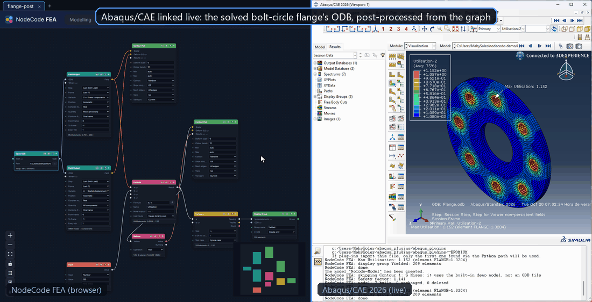
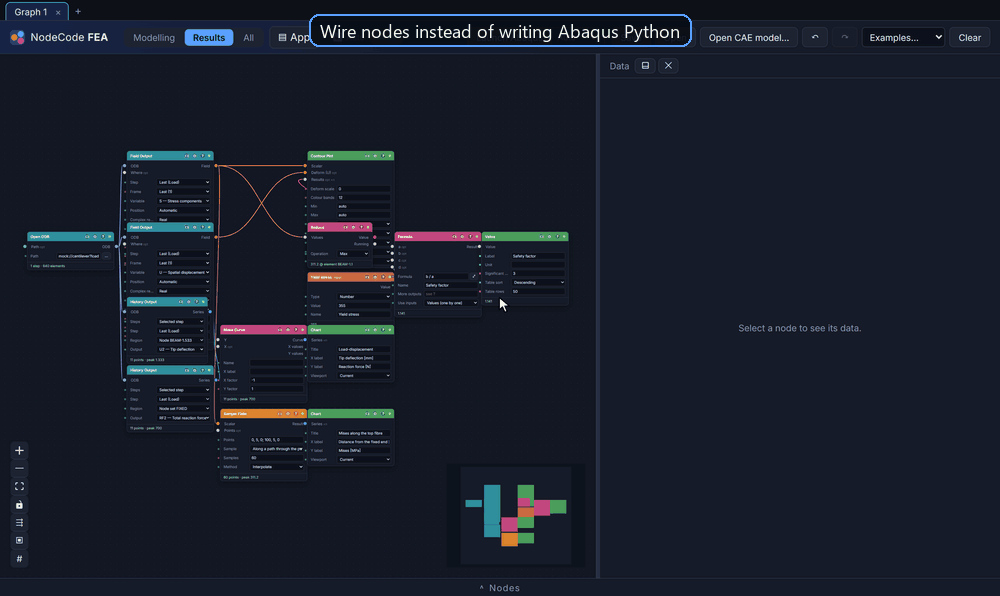
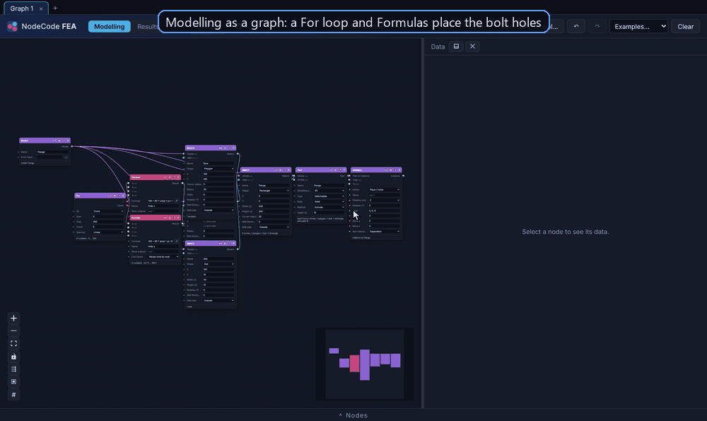
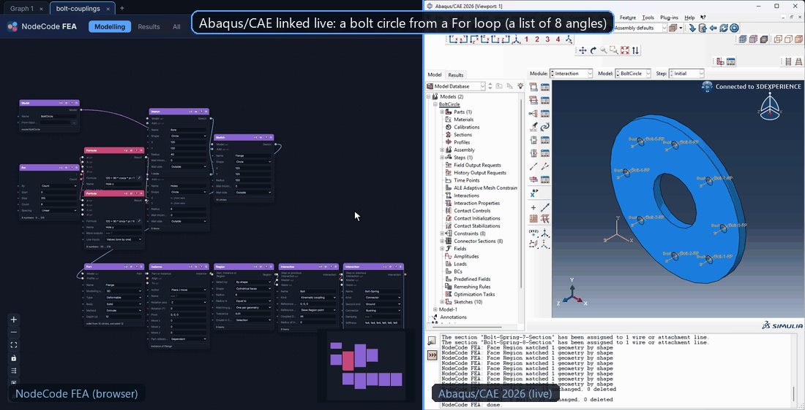
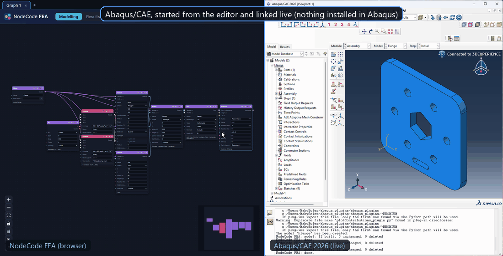

# NodeCode FEA

Node-based visual scripting for Abaqus, in the browser. **Post-processing**: wire up nodes to pull results out
of an `.odb`, compute invariants, filter by sets, reduce to numbers, and view contour plots, charts and tables.
**Modelling**: sketch, part, material, mesh, assembly, steps, loads, interactions and jobs, built live in
Abaqus/CAE, with the results of a job in the same graph. **Live link**: pick in the CAE viewport, show results there.
The graph updates live as you edit it.

*Formerly Abaqus No-Code. An independent project, not affiliated with or endorsed by Dassault Systèmes; Abaqus and
SIMULIA are trademarks of Dassault Systèmes, named here only to say which software this tool works with.*

```
[Open ODB] → [Field Output: S] → [Quantity: Mises]  → [Contour Plot] ← [Field Output: U] (deform)
                                         ↓
                                    [Reduce: Max] → [Formula: 355 / a]   → [Value: safety factor]
```



*A solved flange's ODB post-processed live in Abaqus/CAE 2026: a new variable from a Formula (CAE's Session Step) and the elements over yield as a display group. [MP4](docs/demo-post-cae.mp4)*

It ships with a mock ODB (`mock://cantilever`), an analytical cantilever beam, so you can try
everything without Abaqus installed. `mock://cantilever?instances=2` gives two part instances that share
node and element labels, with assembly-level sets spanning both, like a real assembly.



*The mock cantilever in the browser, no Abaqus needed. [Full-resolution video (MP4)](docs/demo.mp4)*

## Quick start

Requirements: Python 3.10+ and Node 18+. Abaqus 2024 or newer (Python 3) is only needed for real ODBs.

```bash
# backend
cd backend
pip install -e ".[dev]"

# frontend (build once; the backend serves it)
cd ../frontend
npm install
npm run build

# run
nodecode-fea --open        # http://127.0.0.1:8000
```

`nodecode-fea` rebuilds the editor by itself when its source has changed (e.g. after `git pull`), as long as
Node.js is installed, so you always get the editor that matches the backend. Use `--no-build` to skip that.

The example graph loads on first start. Select any node to see its data in the right-hand panel.

### Using your own ODBs

Put the full path to an `.odb` file in an **Open ODB** node. The backend starts one long-lived
`abaqus python` worker process and reuses it for every ODB, so you pay Abaqus' startup time once.

- The `abaqus` launcher must be on your `PATH`. Otherwise set `ABAQUS_CMD`, for example
  `set ABAQUS_CMD=C:\SIMULIA\Commands\abaqus.bat`.
- ODBs from older versions are upgraded to a temporary copy automatically, in the editor and in CAE (e.g. solved
  with 2025, shown in CAE 2026); the copy is made once and reused while the ODB is unchanged.
- If the `.odb` changes on disk (because you re-ran the job), it is reopened on the next run.

### Development

```bash
cd backend && nodecode-fea          # API on :8000
cd frontend && npm run dev           # editor with hot reload on :5173 (proxies /api to :8000)
cd backend && pytest                 # backend tests (Linux, macOS and Windows; no Abaqus needed)
cd frontend && npm run typecheck
```

### Sharing a portable copy (Windows)

```powershell
powershell -ExecutionPolicy Bypass -File tools\make_portable.ps1
```

builds `release\nodecode-fea-portable-<version>.zip` (about 30 MB): the built editor, the backend, an embeddable
Python matching the one that ran the script (64-bit, 3.10+), the dependencies, Tk for the file dialog, a
`start.bat` and a `HOW-TO.txt`. Colleagues unzip it anywhere and double-click `start.bat`; they need no Python, Node
or admin rights, only Abaqus for real ODBs. The package has no editor sources, so it never tries to rebuild the
editor. Building it needs Node.js, pip and internet access (python.org and PyPI); `-Python <path>` picks the Python
and `-SkipFrontend` reuses the current `frontend\dist`.

## How it works

```
Browser (React + React Flow + three.js)
   │  POST /api/run  {nodes, edges}
   ▼
FastAPI backend  ── graph engine: topological order, typed ports, per-node errors, result cache
   │
   ├── MockSource      mock://cantilever?load=…&length=…   (pure numpy)
   └── AbaqusSource ── JSON lines over stdin/stdout ──▶  abaqus python odb_worker.py  (odbAccess)
```

- **`backend/nodecode_fea/worker/odb_worker.py`** runs inside Abaqus Python. It only reads data
  (describe, field, set, history, mesh) and sends arrays as base64. Element results come back one
  value per element: at the centroid, or averaged over integration points if centroid values
  aren't available.
- **`backend/nodecode_fea/nodes/`** defines the node library, one module per area (data, field, maths,
  lists, loops, text, output, and `model/` for the modelling nodes). Each node declares typed ports
  (`odb`, `field`, `set`, `series`, `number`), parameters, a run function, and optional dropdown
  hints computed from upstream data. That's why the step, frame, variable and set dropdowns list
  what's actually in your ODB.
- **`backend/nodecode_fea/engine.py`** evaluates the graph. Results are cached by parameters and
  inputs, so editing one node re-runs only that node and the nodes downstream of it.
- **`backend/nodecode_fea/mesh.py`** extracts the outer surface of the mesh (hex, tet, wedge,
  shell and 2D elements) for the 3D contour view. Element values are averaged onto nodes for
  display.

### Nodes

| Category | Nodes |
|---|---|
| Input | Input (a number, text, Yes/No, list/matrix, or a sketch/part/instance selected in CAE) |
| Model | Model, Sketch, Part, Datum, Region (Pick in CAE / Find at, Set/Surface), Part Feature, Material & Section, Mesh, Instance, Boolean Instances, Step, Load / Boundary Condition, Amplitude, Interaction, Job, Measure |
| Data | Open ODB (a file, a folder or a pattern), Field Output (whole, or one component/invariant), Set (ODB set, typed or picked in CAE), History Output, Steps & Frames, Properties |
| Field | Quantity (component or invariant), Set Operation (topology, set algebra, field on a set), Field from Sets, Over Time, Sample Field |
| Math | Formula, Reduce (with running values), Make Curve |
| Text | Format Text, Replace / Remove, Split Text |
| Logic | Compare, If |
| Loop | For, For Each |
| List | Merge, Count, Pick from List, Sort List |
| Output | Value (numbers, tables, anything), Chart, Contour Plot (deformed, banded legend, hover probe, marked results), Display Group |

46 visible nodes in all.

### Formula: one node for all maths

**Formula** has four inputs, *a*–*d*, that take any kind of value, and the result follows what comes in:

| Inputs | Result | Example |
| --- | --- | --- |
| numbers (or yes/no) | a number, or yes/no for a comparison | `355 / a`, `a > 355` |
| a field (one value per node/element) | a field, or a number if the formula reduces it | `a / 1e6`, `np.clip(a, 0, 355)`, `np.percentile(a, 95)` |
| two or more fields | lined up by instance and label; rows missing from one become NaN | `a - b`, `np.hypot(a, b)` |
| a curve | a curve on the same x (`t` is x); other curves are interpolated onto it | `-a`, `a * 1000`, `a / np.max(a)` |
| a list of numbers | a list (element by element), or a number | `a ** 2`, `np.sum(a)` |
| a list of fields or curves | runs once per item: a list of results | `-a` on every probed curve |
| a set | its labels, as a list of numbers | `a * 10`, `np.max(a)` |

Numbers mix with all of these (`a / b` with a field *a* and a number *b*). Fields need a single component
(after Quantity), and nodal and element fields don't mix. Formulas go through a small whitelisted
evaluator, not `eval`. Expression, Field Math and Series Math, which Formula replaces, are no longer in the node
list; graphs saved with them still run.

**Tables: index what you see.** A field or curves in a Formula can be indexed exactly like the table the data
panel shows, as in Python: `a[row, column]`, counting from 0. The panel numbers each column header and shows each
row's number (*row*; field tables are sorted by value, so the top row is usually not row 0). For a field with
columns *Instance, Element, S Mises*: `a[:, 0]` is the instance names, `a[:, 1]` the element labels, `a[:, 2]` the
Mises values, `a[5, 2]` the Mises value of row 5. Curves (e.g. Over Time on several nodes) have a *Table* button
in the panel: rows = curves, columns = *Instance, Node* (or *Element*), then one column per frame, so `a[:, 2]` is
every node's value at the first frame and `a[:, 2:]` all the values.

No setting is needed: any input indexed with two indices (`a[:, 2]`, `a[0, 3]`) is its table; used plainly
(`a / 2`, `-a`) it is its values as before, and tensors keep their 3×3 indexing (`a[:, 0, 1]`). *Use inputs: As
tables* makes every field and curve input a table even when not indexed that way.

The result is plain, as in Python: one value gives a number (or a text), a column or a row gives a list (`a[:, 2]`
is just the Mises values, shown as `#, Value`), a block gives a matrix (`a[:, 2:]`, `a[:, 2:].T`). Numbers of one
column still remember their node/element, so Reduce Max on them knows where the peak is. To keep a field (for a
Contour Plot) or curves (for a Chart), use the input plainly: `a / 2`, `-a`.

| Table of | Columns |
| --- | --- |
| curves | Instance, Node/Element (or Curve, for curves of no node), then one per point (frame); `t` = the times |
| a field | Instance, Element/Node, then its components (Mises: one; S: S11…S23) |
| several one-value fields (e.g. one per frame) | Instance, Element/Node, then one per field; `t` = their frame times |

The first columns name the rows and aren't values, so maths on the whole table (`a * 2`) says to take the value
columns (`a[:, 2:] * 2`).

**Scripts: more than one line.** The **⤢** button beside the formula opens a code window for a small script.
It has line numbers, autocomplete (including the script's own variables), Tab / Shift+Tab to indent, automatic
indentation after `:`, and a side panel showing what each input *a*–*d* is wired to, the *More outputs* and the
node's result or error. A line with an error is highlighted. **Ctrl+Enter** runs the script, **Esc** or **Done**
closes the window and keeps the code, and **Cancel** drops the changes made since the last run. On the node, a
script shows as its first lines; click them to edit.

```python
peak = np.max(a)
if peak > 355:
    note = f"over yield: {peak:.0f} MPa"
else:
    note = "ok"
ratio = a / peak        # a field in, so ratio is a field too
ratio                   # the last line is the Result (or set result = …)
```

- Scripts can use variables, `+=`, `if/elif/else`, `for … in …` (over `range(n)`, lists, the rows of a
  matrix, `enumerate`, `zip`), `while`, `break/continue`, `def f(x, k=2): … return …`, `lambda`, list and dict
  comprehensions, lists and dicts (`x.append(1)`, `d["L"] = 2`), texts and f-texts (`f"{peak:.1f}"`),
  `assert cond, "message"`, plus everything a one-line formula accepts. `min(list)` / `max(list)` give the
  smallest and largest value.
- **More outputs** (`peak, note`) turns script variables into extra output ports after *Result*, named after the
  variables (up to four). Each one follows the inputs the same way the Result does: a per-row array becomes a
  field, a per-point one a curve, and a number, text or list stays as it is. A list of fields runs the script once
  per field and gives one value per field on every port.
- Scripts are still interpreted from a whitelist, not run with Python's `exec`: there are no imports, no files and
  no `__…__` attributes, and only a few safe methods on lists, dicts, texts and arrays. Inputs are copied, so
  `a[0] = 0` never changes the node upstream. Loops stop after 2,000,000 rounds, so an endless `while` gives an
  error instead of hanging. Each error names its line (`Line 6: Unknown name 'pk'`).

### Modelling (preprocessing, first steps)

The model and its results are **one graph**: a Job's *ODB path* wires into Open ODB, so the results follow the model
(change a thickness, run again, the curves update) and a parameter study is one chain from the design values to
the curve. The top bar's **Modelling**, **Results** and **All** only choose what is shown: Modelling hides the
results side, Results the model side (a Job, the bridge, shows in both; inputs, maths and lists go with the nodes
they feed), All shows everything. Hidden nodes still run, and the node list offers what fits the view. One
autosave and one undo; Save writes the graph to one file. Graphs from the two-tab versions (in the browser, or
saved files with both tabs) open merged: the model to the left of the results. Launch / Live / Sync send the whole
graph: CAE builds the model and draws the results, and the node clicked last owns CAE's current viewport (a
modelling node: shown there, the results' outputs in it wait; a Contour Plot or Chart: drawn, the model built but
not shown). A graph without modelling leaves CAE's models alone; removing the last modelling node deletes what it
made. Examples replace the graph (Undo brings yours back) and open in their view.



*The 3D preview needs no Abaqus. [MP4](docs/demo-modelling.mp4)*

When a modelling node is shown in CAE, the link switches to the appropriate modelling module and selects CAE's
**Model** tree tab, so the tree corresponds to the model or part currently displayed instead of a previous results
context such as `Model-1`.

Sixteen nodes in the **Model** category build and inspect models in Abaqus/CAE, in Abaqus's own order: **Model → Sketch →
Part → Datum / Region / Part Feature → Material & Section → Mesh → Instance / Boolean Instances → Step → Amplitude →
Load / Boundary Condition / Interaction → Job / Measure** (see `docs/preprocessing-plan.md` for the design):

- **Model** starts a model (default `NoCode-Model`), empty or **from an input file** (*From input file*: an
  Abaqus `.inp`, imported whole with its parts, materials, sections, assembly, steps and loads, to check, change and
  run; choose its parts or instances with an Input set to Part / Instance in CAE, add steps, loads or a Job, and the
  model checks and the Job's Check work on it). To edit what the file defines node by node instead, open it with
  **Open CAE model…** (see *Open a CAE model as a graph*). Wire it into Sketch (or Part). A Part without its own Model
  goes into its sketch's model, else `NoCode-Model`; a part wired to another model gets a copy of the sketch there.
  A sketch with no Model goes into the models of the parts made from it (no part: `NoCode-Model`).
  A Sketch, Part or Step whose Model isn't wired is built in the graph's Model node (with several, the one selected
  last, else the first), not in `NoCode-Model` beside it; a new one also starts wired to it, so it shows. A Part
  made from a sketch goes where its sketch is. With no Model node, they go into the model of a sketch, part or
  instance chosen from CAE (an Input), so work on an existing model stays in it; `NoCode-Model` is only used when
  there is neither. (A Model node named like an existing CAE model would replace it: work on an existing model
  through Inputs instead.) Every Modelling example wires its sketches, parts and first step to its own Model.
- **Sketch** draws a named flat profile in the XY plane (kept in CAE by its *Name*): *Shape* Rectangle (width × height from its lower-left corner
  *X, Y*; *Corner radius* rounds its corners), Circle (*Radius* about its centre *X, Y*), Arc (radius, start/end
  angles and direction), Polygon (regular, *Sides*, *Radius* to its corners), Ellipse and Slot (*Width* × *Height*
  about the centre; a slot rounds the ends of its longer side), Spline, or Profile. Polygon, Ellipse and Slot turn by
  *Rotation*. *Corner radius* also rounds every corner of a Polygon or Profile (open or closed) with tangent arcs
  (fillets, inside corners too), drawn in CAE as lines and arcs; a radius too big for a corner says how big it can
  be there. Wire lists into *X, Y* (e.g. For + Formula) for patterns of holes. Spline and Profile accept
  points `x, y; x, y; …`, a matrix or a curve wired into *Points*, moved by *X, Y*; *Closed* joins their last point to the first. Sketches wired into *Add* are combined with it:
  a loop inside a closed loop is a hole (a plate with a hole is a Rectangle with a Circle added). **Wall
  thickness** (offset) draws a Rectangle, Circle, Polygon, Slot or Profile as a wall: a closed shape with its offset
  copy inside or outside it (or centred on it), so the space between is a tube's or hollow section's wall, and an
  open Profile as a closed band along it (a C-channel, an angle or a Z-section from its centreline). Corners are
  mitred (sharp); a rounded shape's offset copy gets its corner radius plus or minus the thickness. The data panel
  draws it to scale. The node only shows the settings of the chosen shape.
- **3D preview, no CAE needed**: the data panel draws Parts (planar, extruded and revolved, and 3D wire frames) in
  3D, from their profile; a **Datum** shows its part with the plane (a see-through square), axis or point in yellow
  (a face-offset plane only marks the face's picked points: where it lands is worked out by CAE); an **Instance** shows the whole assembly, itself highlighted and the model's other instances in
  grey, each where its last Instance node puts it; a **Region** picked at points shows them as red dots on the part
  or assembly, so a pick that misses shows before CAE builds it. Fillets, chamfers and extruded cuts/adds aren't
  drawn (the view names them); imported, merged and CAE-picked parts show their details instead.
- **CAE's mesh in the preview**: once the live link has built a meshed part, each sync also brings back the mesh
  CAE generated (its surface element faces, or beam segments), and the Mesh node and the nodes after it (Material &
  Section, Part Feature, Datum) draw it instead of the profile; the Part node before the Mesh (and anything on it)
  keeps showing the geometry. An **Instance** of the meshed part draws it where it is in the assembly,
  among the model's other instances. A **Region** on a meshed part or instance (or a Mesh node seeding
  one) draws that mesh with the Region's element faces, edges or nodes in orange, so local seeding shows without
  switching to CAE. The mesh is asked for again whenever the part or its seeds change; a mesh past 30,000 element
  faces is only counted, and a Region that a later Part Feature removed (the holes Remove faces fills) says so.
- **Part** makes a part from a *Profile* (a Sketch, or points: a matrix, a curve, a wired text), or imports a
  STEP, IGES or SAT solid/shell through **Import CAD** (its file picker lists those formats), or the **mesh of an
  Abaqus input file** (`.inp`: an orphan mesh, no geometry; *Part in file* picks one of a file with several, else
  the only or first one; it is already meshed, so Mesh refuses it: give it a Material & Section (its elements), place
  it, and find faces and holes on it By shape). For generated geometry, *Body* can be **Shell**
  (plates, walls), **Wire** (beams, frames) or **Solid**, by *Method* **Planar** (the flat profile: a plate, a
  wire), **Extrude** (along z by *Depth*: a box or tube of shell walls, a block) or **Revolve** (about the y axis
  by *Angle*; keep the profile at x ≥ 0). Points with z (e.g. a matrix `[[0,0,0], [0,0,300], [200,0,300]]`) make a
  3D wire frame.
  *Modelling space* **2D planar** or **Axisymmetric** makes a flat part from the profile (Method Planar; Body Shell
  for the area, Wire for its edges): plane stress or plane strain by the element type (CPS…/CPE…), or turned about
  the y axis (CAX…; keep the profile at x ≥ 0; forces and reactions are over the whole round). Their sections are
  solid sections (Material & Section's *Out-of-plane thickness* for 2D planar), pressure, ties, contact and couplings
  go on Edge Regions, and instances only move in x, y (axisymmetric: along y) and turn about Z. A model can't mix
  spaces (a check says so).
  *Type* **Discrete rigid** (a meshed rigid surface: a 3D shell with R3D4/R3D3, a 2D wire with R2D2/RAX2) or
  **Analytical rigid** (exact, unmeshed: a 3D profile extruded or revolved 360°, a 2D wire) makes a tool, die,
  punch or rigid wall for contact. It takes no Material & Section; it moves by its reference point (Part Feature →
  Reference point; hold or drive the point it outputs). An analytical surface's Side 1 is on the left walking along
  its profile (a line drawn left to right faces up): to touch what is on the other side, make its Region a Surface
  with Side 2.
- **Datum** creates a named principal/three-point/face-offset plane, principal/two-point axis, coordinate point,
  or **Coordinate system** (Cartesian, Cylindrical or Spherical, from three points: its origin, a point on its first
  axis and one in its 1-2 plane) as one reversible CAE feature. An assembly coordinate system (made from an Instance
  or the Model) wired into a Load / Boundary Condition's *Coordinate system* turns its components into local
  directions (radial, around, along an axis). A Part input creates it at part level; an Instance or Model creates it in the root
  assembly (points are then assembly coordinates, and an Instance Face can define an offset plane). Points and Face
  Regions are inputs; settings are wireable and lists map normally. Part Feature partitions require a part-level
  plane Datum.
- **Part Feature** modifies a Part and returns the Part for further features or instancing. **Partition** uses a
  connected Datum and partitions all cells, or all faces for a shell; wire a Region to restrict it. **Partition by
  extending a face** cuts a solid's cells along the extension of one face (*Face to extend*; a Cell Region limits
  which cells), the usual way to make a stepped or holed part hex-meshable. **Partition by a sketch on a face**
  draws a Sketch on one face and splits the face along it (a load footprint, a contact patch). **Split edges**
  cuts each edge of an Edge Region at a fraction of its length (a point for a load or a seed). The same node
  applies **Fillet** or **Chamfer** to a connected Edge Region. **Extrude add** and **Extrude cut** place a closed
  Sketch on one planar Face Region and add or remove solid material by *Depth*. **Defeaturing** (cleaning up CAD
  before meshing): **Remove faces** takes out a Face Region's faces and closes the gap by extending the faces
  around them (`RemoveFacesAndStitch`): small holes, fillets, chamfers, bosses. Feed it Region *By shape* with
  *Radius is* **Up to** (every hole/fillet no bigger than the radius) or *Small faces* (area up to a size).
  **Remove wire** deletes the edges of an Edge Region (`RemoveWireEdges`): lines of a Wire part, or loose wire
  edges that bound no face.
  **Repair small edges** / **Repair small faces** merge edges shorter / faces smaller than *Smaller than* (among a
  wired Region's, or the whole part) into their neighbours; **Remove redundant entities** drops edges and vertices
  that split nothing (on a part with none, the node just notes *none were redundant*). CAE reports on the node how many faces it removed and how much the volume changed (*In CAE:
  Remove faces (6 faces) changed the volume by +0.3 %*). To suppress a feature the editor made, deactivate its
  node. **Thin solids as shells**: **Solid to shell** keeps a solid's faces as a shell (its skin, `RemoveCells`; a
  Face Region's faces are left out to open it), **Midsurface** makes the shell halfway between the Region's faces and
  the *Opposite faces* (a plate's top and bottom: `AssignMidsurfaceRegion` + `OffsetFaces`). From then on the part
  is a shell: Material & Section (Automatic) gives it a Shell section with your thickness, Mesh shell elements; put
  them after the Part Feature. **Reference point** (RP, remote or control point) adds one to the part at *At*
  `x, y, z` (part coordinates; `part.ReferencePoint`, named by *Feature name*), so every instance of the part carries
  it; the 3D preview shows it as a yellow dot. Its **Reference point** output (shown for this operation) goes
  straight into a Load / Boundary Condition's Region (force, displacement, fixed: on every instance), a coupling's
  Master (its control point: RBE2 / RBE3), a connector's end, or a Step's History region. Put it before Mesh, like
  the other features. Picked CAE Parts are modified in place: deleting
  the node removes only its reversible feature from CAE's
  feature tree. Older graphs with plane and offset stored directly on Part Feature continue to work.
- **Region** selects faces, edges, vertices or cells on a Part or Instance. Choose **Pick in CAE** to show the pick
  button, or **Find at** to show its point input and wire one or more `x, y, z` points from text, a matrix or another
  node. A zero *Tolerance* uses Abaqus `findAt`; a positive tolerance selects the nearest entity within that distance,
  rejects every unmatched point, removes duplicate matches and reports the actual unique match count in CAE.
  **From a CAE set** (the list under *Pick in CAE*) takes over a Set or Surface you made in CAE. It lists every
  geometry Set and Surface of the models in CAE: a part's, and an assembly's split per instance. Choosing one fills
  *Geometry*, *Selection*, *Create in CAE* and *Name*, so NodeCode FEA makes the same named Set/Surface. The geometry is
  kept as one point on each face/edge/vertex/cell, not CAE's indices, so it is found again when the graph rebuilds
  the part (e.g. after a dimension change). Wire the set's Part to *source* (an Instance for an assembly set). It is a
  one-off copy: later edits to the set in CAE don't come back; choose it again to update.
  **Mesh labels** selects a mesh's **Nodes**, **Elements** or **Element faces** by label, as an input file names them:
  `1-9, 12` (nodes, elements), `S2: 1-8; S4: 12` (element faces by face, S1 to S6). It works on any meshed Part or
  Instance, and is how sets and surfaces of a mesh with no geometry (an imported input file) are selected: nodes
  for concentrated forces and BCs (a node set), elements for Material & Section (an element set; elements of a shell
  part make a Surface on their side), element faces for pressures and contact (an element surface). CAE says which
  labels the mesh doesn't have.
  **By shape** finds every *Cylindrical faces* (holes, bores, pins, fillets; a *Radius* within *Tolerance*, any
  with 0, or with *Radius is* **Up to** / **At least** every one no bigger / no smaller; CAE's `getRadius()` also answers for a cone, so a face whose circular edges don't share its radius is
  left out), flat *Circular faces* (partitioned discs and support pads), *Circular edges* (e.g. to fillet every
  hole edge), *Flat faces* whose normal points along *Facing*, or *Small faces* of an area up to a size (chamfers,
  slivers, tiny details to remove).
  When a *Radius* matches nothing, the error lists the radii that are there (e.g. "found no circular faces of
  radius equal to 18 …; the radii here are 9": a diameter typed as the radius).
  On a part or instance that is **only a mesh** (an imported input file, a part made from a mesh) there is no
  geometry: its outer element faces are grouped into smooth patches and a patch is a hole when its normals are all
  perpendicular to one axis and its nodes lie on a circle (fitted: radius and center). Loads and Surfaces then use
  those element faces, Sets and BCs their nodes, and Measure lists one radius/center per hole;
  feed it to a Pressure, a coupling's Slave, a Part Feature… like any Region. *Matching geometry* can return all
  matches together or one Region per match, located at its true CAE centre. Measure *Count*, *Radius* and
  *Center* list what it found (the Modelling example *Find every bolt hole By shape* loads all eight holes of a
  flange and lists them).
  **Combine Regions** with **Set Operation** (Union / Intersection / Difference): e.g. every face By shape minus
  the top one, or two picks added together. Both must be on the same Part or Instance and select the same kind
  of geometry (a list on one side is its union first). CAE resolves the result by entity when it builds the model
  (an empty result is reported), and it is a Region like any other: load it, feature it, or name it as a Set or
  Surface with another Region node.
  **Any geometry** starts with Vertex, then lets you choose Face, Cell or Edge while picking. Selecting the Region node highlights those exact entities
  in CAE: every region when it gives a list or matrix of them (on the part when they are all on it, else on the
  assembly), and so does selecting a general node that passes Regions on (Merge, Pick from List, Compare…). Keep it as a
  graph **Selection**, or create a reusable named CAE **Set** or **Surface** (faces/edges, Side 1 or Side 2).
  Part sources create part-level repositories; Instance sources create assembly-level repositories. A Region made
  on a Part can still go into a Load / Boundary Condition, Interaction (tie, contact, coupling) or a Step's History
  region, which CAE wants on the assembly: it is applied to the same faces/edges on **every instance of that part**
  (CAE reports "applied on its N instances"; with none it asks to place the part with Instance first), so a set
  made once on the part loads every copy. Make the Region on an Instance to load only that one. With a mapped list
  of Instances, *Mapped sources* can create **One per source**, or **One combined assembly region**: a single
  named Set/Surface containing everything this Region node found across the list. One Region works wherever that
  geometry is needed; lists of sources or point tables otherwise produce and name lists of regions. To filter
  geometry, connect a matching Yes/No list to **If** *Condition* and the Region to *Then*, leaving *Else* empty;
  the result contains only the Yes faces/edges/cells. Feed that result into another Region and choose *Create in
  CAE* **Set** or **Surface**. A filtered list of Regions can likewise be made into one combined named region.
  CAE reports a clear error if the resulting selection contains no geometry.
- **Measure** returns a number from live CAE geometry: face area, edge length, cell volume, or the distance or angle
  between two Regions/objects; or from its mesh: *Nodes*, *Elements*, *Worst/Mean aspect ratio* and *Failed
  elements* (Abaqus' analysis checks), for a meshed Part, an Instance or a Region; or what a Region found:
  *Count* (how many faces/edges), *Radius* (one per face/edge: holes, fillets; NaN for one that isn't round) and
  *Center* (x, y, z: one found entity is one three-value row, several are a table; a cylindrical face's centroid,
  on its axis; a circular edge's center; a cell's centroid). A mapped list with one center per item is therefore an
  ordinary N × 3 matrix, so Formula can use `a[:, 0]`, `a[:, 1]`, or `a[:, 2]` directly. The first sync asks CAE,
  caches its answer, and immediately reevaluates the graph;
  geometry changes automatically produce a new query. Lists and nested lists map like other nodes. A Region made
  on a part before later Part Features (say the holes a Remove faces then fills) is measured on the part as it was
  then: on a temporary copy with those features suppressed, so the part itself and its mesh are untouched.
- **Model checks**: as you edit, nodes get an amber warning for what Abaqus would refuse or get wrong, and the top
  bar shows "⚠ N to check" (click it to go from one to the next; the data panel lists a node's warnings in full):
  a placed part with no Material & Section or no mesh; an instance that **nothing holds** (no boundary condition on
  it or on what it is tied, coupled, connected or in contact with: Abaqus would stop with a zero pivot; Frequency
  and explicit models, where a free body just moves, excepted); no density with a Dynamic/Frequency step or
  Gravity; element types Abaqus/Explicit lacks (C3D20R, C3D8H, C3D10H, S8R) in an explicit model; a displacement,
  force or pressure without amplitude in an explicit step (applied at once: a shock); Young's modulus and density that aren't in
  one unit system (MPa with kg/m³…) and gravity that doesn't match the units (9.81 in a mm model); a Sketch that draws the same item twice (a ring of holes at 0…360° repeats the first: CAE says "feature failed"); a Job of a model
  with no Step or an empty assembly; and common engineering slips Abaqus accepts silently: fewer than two linear
  hexes (C3D8R) through a solid's thickness (too stiff in bending), linear tetrahedra (C3D4), a concentrated force on
  several vertices (it acts in full at each), a pressure that is a sizeable fraction of Young's modulus (units), an
  amplitude that ends before its step, two boundary conditions on the same faces, a tie or contact of a face with
  itself. The Job's **Check** button runs Abaqus' own data check of the written input
  (`abaqus datacheck`, as job `<name>-Check`, without solving and apart from the results); each of its errors and
  warnings goes on the node that made what it names (a material, a load, a part without section…), the rest on the
  Job, and they say so when the model changed after the check. A run that fails puts its errors on the nodes the
  same way (*Run error: …*). With the live link, what CAE couldn't build at the last update (a pick that found no
  face, a feature CAE refused) shows on the node that makes it (*In CAE: …*) until an update builds it.
- **Job** defines an analysis job for a Model or the last Step/condition/interaction. CAE only writes its input file
  as the model changes (never while the job runs) and never submits it, so editing the model doesn't restart an
  analysis. **Run** solves it from the editor (`abaqus job=… interactive` in the working directory; a list of jobs
  runs one at a time, in order) and **Kill** stops it. **Results** sends it to post-processing: it wires the Job's
  *ODB path* into Open ODB (one already fed by it, else the first one no other Job feeds, replacing its typed path;
  else a new Open ODB next to the Job) and shows the Results view, also while the job still runs. *User subroutine*
  (a `.f`/`.for`/`.obj` file) is compiled into the run (`user=…`), e.g. the UAMP of a User Amplitude. *Run* = **Run on request** (only the button), **Run
  automatically** (whenever the input is newer than the results; once per input, also after a failure or Kill) or
  **Write input only**. The node shows the state read from the job's files (Input written, Queued, Running with the
  step/increment/time from `.sta`, Completed, Failed with the first errors, Killed) and *Model changed since this
  run* when the input is newer than the results. **Show** switches the node from its state to one of the files
  Abaqus writes as it runs, read live (also for jobs started from CAE's Job Manager): **Status (.sta)** (one line
  per increment), **Messages (.msg)** (iterations, warnings, errors), **Data (.dat)** or **Log (.log)**, kept
  scrolled to the end as it grows, with errors in red and warnings in amber (long files show their last 200 kB).
  Outputs *File text* (that file; State: the .sta) for the Text nodes, and *Increments*: total time and time
  increment per increment from the `.sta` (Standard and Explicit) as curves, to chart convergence. Its ODB-path
  output wires into **Open ODB**, which **reads the results written so far while the job runs** and updates with
  each increment (the node says *Running: results so far*), then once more when it ends; when Abaqus put
  problem nodes/elements in sets (*… identified in element set WarnElemDistorted*) the node lists them under
  *Problem sets*: a **Set** with `Warn*, Err*` on the job's ODB gives them, to highlight in a contour or in CAE.
  While it runs and after, the node warns about how it converges (*Convergence: …*): many cutbacks, a time
  increment collapsing towards a stall, and the solver's known complaints with what usually helps (too many
  attempts, below the minimum increment, zero pivot / singularity = something free to move, negative eigenvalues,
  excessive distortion, overconstraints, large plastic strain per increment, overclosures, Explicit's deformation
  speed), plus where the largest residual force was when it stopped; CAE outputs of those
  results update too (`Odb.update()` on the open ODB). Empty working directory: `~/nodecode-fea/jobs`. Name,
  directory, CPUs and memory are inputs, so lists make parameter-study jobs (shown as one status table).
- **Mesh** seeds, controls, assigns element types and optionally generates a Part mesh. A Part target gets a global
  seed; an Edge Region gets a local seed; Face/Cell Regions restrict controls and element assignment (on a solid,
  to the cells around the faces) and, with *Face/Cell Region seed* = *Its edges*, seed just the edges around those
  faces or cells (By size or By number) instead of the whole part. Automatic
  element types choose B31, S4R/S3 or C3D8R/C3D4 from the part and requested shape; also offered are quadratic
  B32, S8R, C3D20R and C3D10, incompatible-mode C3D8I (bends right with one element through a thickness), and the
  hybrid C3D8H / C3D10H for rubber, and the modified tetrahedron C3D10M (contact). 2D parts take plane stress
  CPS4R/CPS4/CPS8R/CPS3, plane strain CPE4R/CPE4/CPE8R/CPE3/CPE4H, 2D beams B21/B22 (Automatic: CPS4R, B21),
  axisymmetric CAX4R/CAX4/CAX8R/CAX3/CAX4H and axisymmetric shells SAX1 on a wire (Automatic: CAX4R, SAX1);
  discrete rigid parts R3D4/R3D3, R2D2, RAX2. An element of another family is refused, naming the ones that fit.
  *Element shape* adds Hex-dominated and Quad-dominated; an element type of the
  other shape (C3D10 on a hex mesh) is refused, since CAE would silently use its default. Picked CAE parts are copied
  before meshing, and lists of targets or settings produce corresponding meshed parts (a mesh convergence study).
  *Seed* is *By size*, *By number* (elements per edge: the Edge Region's, or every edge of the part) or *Biased*
  (an Edge Region graded by *Bias ratio*, finer at the start, end, both ends or the middle; start and end follow
  each edge's direction). Chain meshes for local refinement: Mesh the part, take an Edge Region of the result (or a
  Face Region with *Its edges*), Mesh that.

**A part stays one part.** Material & Section, Mesh and Part Feature edit the part they are given: their output is
the same CAE part, not a copy. Everything done to a part anywhere in the graph, in a chain or on side-by-side
branches, builds that one part in graph order, and a Region, Instance or Measure wired from any stage of it uses
it (a Measure of a Region taken before a Part Feature still measures the part as it was then). Separate parts are
made on purpose: run an edit over a list (Mesh over sizes 10, 5: one part per size, the first keeps the name; a
stage before the list is the first) or give the part another name. Two Mesh nodes that both seed the whole of one
part get a warning: the later seed replaces the earlier, so refine with a Region instead.
- **Instance** can be **Dependent** (follows its Part) or **Independent** (copies geometry into the assembly).
  **Boolean Instances** merges a list of Instances, optionally retaining intersections, or cuts one target with a
  list of cutting Instances. It returns a new Part; *Original instances* chooses whether its graph-created source
  Instances are **Keep** (restored after the operation) or **Delete** (consumed). *Result in assembly* independently
  chooses **Part only** or **Place in assembly**. Placing also exposes the **Result instance** output; feed that into
  Instance when it needs moving, turning or aligning.
- **Material & Section** defines one material (elastic, optionally elastic-plastic) and assigns a solid, shell or
  beam section in the same operation. It supports optional density, shell thickness, rectangular/circular beam
  profiles and beam n1 orientation. *Hardening* is Isotropic (the Plastic table), **Kinematic** (linear: Plastic is
  two rows), **Combined** (from a half cycle) or **Johnson-Cook** (A, B, n, m, melting and transition
  temperatures); *Fracture strain* adds **ductile damage** (it starts at that equivalent plastic strain and is
  complete after *Displacement at failure*). *Conductivity*, *Specific heat* and *Expansion coefficient* are the
  thermal properties (heat transfer, transient heat transfer with density, thermal expansion). A 2D planar or axisymmetric area gets a solid section (2D planar: with its
  *Out-of-plane thickness*), an axisymmetric wire a shell section; rigid parts take none. *Plastic* is isotropic hardening as plastic strain, yield stress pairs from 0
  plastic strain (`0, 250; 0.1, 350`; one row is perfectly plastic), typed or wired as a matrix or a curve (x =
  plastic strain, y = stress, e.g. test data through Make Curve). A Region restricts the assignment; a Part applies it everywhere. Picked parts are copied, and
  lists of properties produce separately named materials/sections for parameter studies. **Composites**: *Behaviour*
  **Lamina** is an orthotropic ply (E1 along the fibres, E2, ν12, G12, G13, G23; shells only) and **Engineering
  constants** the full orthotropic set for solids; *Section type* **Composite shell** stacks *Plies* (angle in
  degrees, thickness; from the bottom; typed `0, 0.125; 45, 0.125` or wired as a matrix), optionally *Symmetric*
  (type half the layup). *Fibre direction* `x, y, z` gives the material its 1-direction (a datum csys
  `<section>-Csys-1` and a material orientation; projected onto shells); ply angles turn from it about the normal.
  *Behaviour* **Neo-Hooke**
  or **Mooney-Rivlin** makes it hyperelastic rubber from *C10* (and *C01*) and *D1* (compressibility, 2 / bulk
  modulus; 0 = incompressible, which needs the hybrid elements C3D8H / C3D10H on Mesh — the model checks say so).
  *Damping α / β* add Rayleigh damping (α × mass + β × stiffness) for dynamic steps. A material already defined
  in CAE can be **chosen from the node's material list** (every model's materials, ⟳ lists them again; *New
  material* goes back to the settings, which are hidden meanwhile). *Existing material or
  section* takes an Input set to *Material in CAE* or *Section in CAE* (it wins over the list): a material is used for this node's section
  (its material settings are ignored), a section is assigned as it is (with its own material). From another model
  — a material library model — they are copied into the part's model by name (`copyMaterials` / `copySections`;
  the library is only read). Picking from the very model the graph's Model node rebuilds is refused, since the
  rebuild would delete them.
- **Step** creates Static, **Static Riks** (arc length: snap-through, post-buckling, collapse loads; *Time period*
  is the total arc length, the increments are arc length increments, *Maximum load factor* stops it once the loads
  reach that multiple), implicit Dynamic, explicit Dynamic, Frequency, **Buckling** (linear buckling: *Eigenmodes*
  critical load factors of the step's loads), **Heat transfer** and **Coupled temperature-displacement** (thermal
  stress in one step) procedures, the last two *Steady state* or *Transient* (with *Max temperature change* per
  increment for automatic increments). A heat transfer analysis has only heat transfer steps; Frequency and Buckling
  are perturbation steps after a Static one or the Model. Feed it a Model for the first
  step or another Step to chain them. Time/increment controls, geometric nonlinearity and eigenmode count are
  wireable and listable; invalid general/perturbation sequences are rejected before CAE runs. *Dynamic explicit*
  (Abaqus/Explicit: impact, drop tests, short events) has a *Time scaling factor* on the stable increment and a
  *Mass scaling increment* (semi-automatic mass scaling of the whole model, at the step's start, of elements whose
  stable increment is below it; 0 = none). Abaqus doesn't mix Explicit and Standard steps in one model, so an
  explicit step follows only the Model or another explicit step; in such a model contact is built with the Explicit
  types (`ContactExp`, `SurfaceToSurfaceContactExp`). Its output requests: *Field outputs* (the
  variables written each frame, e.g. `U, RF, S, PEEQ`, `ALL`; empty = Abaqus' preselected ones), *Output frames*
  (evenly spaced frames; 0 = every increment) and *History outputs* (e.g. `RF2, U2` every increment at the
  *History region* input, a Region on an Instance; without one, whole-model variables such as `ALLSE, ALLWK`). They
  are built as their own CAE object, so changing them rewrites the job input without rebuilding the step or its
  loads; clearing them restores Abaqus' defaults in that step.
- **Parameter studies** need no special node: a list into a design setting maps through the whole chain. Give each
  design its own model by wiring a list of names into Model's *Name* (Format Text `Bar-{a:g}` over the same list),
  and everything made at that position inside it keeps its plain name (Part `Bar`, Step `Load` in each model). Job
  then makes one job per design, **Run** solves them in turn, and its ODB-path list into Open ODB → Field Output →
  Reduce gives one number per design, ready for Make Curve against the design list.
- **Load / Boundary Condition** applies fixed or prescribed displacement/rotation constraints, concentrated forces,
  pressure, or gravity in a Step. *Fixed* is **All** (encastre), **Pinned** (displacements), or **X/Y/Z symmetry**
  and **antisymmetry** (XSYMM… on a symmetry plane: half and quarter models). A *Coordinate system* Datum makes
  Fixed (symmetry, pinned), Displacement and Concentrated force act along its axes. In a Heat transfer or Coupled
  temperature-displacement step it also applies **Fixed temperature** (a temperature boundary condition, also in
  Initial), **Heat flux** (into faces) and **Convection** (a film condition: *Film coefficient* h and *Sink
  temperature*); all three change by step like the others. A heat transfer step takes only these (and Temperature
  as the initial condition). Feed one condition into the next to add several to the same step. Geometry comes
  from a Region (pressure requires faces and concentrated force requires vertices); gravity needs no Region. All
  components and magnitudes are wireable and listable, so one list can generate a family of load cases. Prescribed
  displacement/rotation components accept a number or `Free`, so unspecified degrees of freedom remain unconstrained.
  **Changing by step** keeps one node for one physical condition across a chain of steps. Every value setting
  takes its value where the condition is created, then `Step: value` changes, each holding until the next:
  *Z component* `-9810; Horizon: 0`, *Pressure* `1; Wind: 2`, *U2* `0; Release: Free` (frees it there), *Bolt
  force* `10000; Retighten: 15000`, *Amplitude* `0, 0; 1, 1; Wind: 0, 1; 1, 0` (`Wind:` alone goes back to Abaqus'
  default). The node's **Per step** table (always open: one row per step of the model, an **Active** checkbox and a
  column per value) edits these texts; empty cells show, greyed, the value that holds from the step before. Active
  starts ticked from the node's Step onward (the Step input is where it starts; the table lists every step of the
  model, also later ones); untick a step to switch it off there (`Initial` is offered for boundary conditions and
  temperature); values typed in an unticked step are kept and hold when it is on again. Off in a step deactivates it there; on again later makes a fresh copy `<name>-from-<step>` (Abaqus
  can't reactivate one); a load whose values all become 0 is removed there the same way (CAE refuses an all-zero
  load). The ticks are kept as the Active in setting (`Zenith to Horizon, Wind`), which is wireable.
  The **Per step** input takes the whole table from another node (an Input matrix, a Formula, text rows): a header
  row `Step, Active, Z component, Amplitude` (setting names or labels) and one row per step, `Yes`/`No` for Active,
  empty cells keeping the step before's value; its values win over typed ones in the same step, its Active column
  replaces the ticks, and the node's table shows the result.
  **Temperature** is a predefined field on the Region's nodes: the plain value is the initial temperature (made
  in Initial), `Heat: 200` changes it in a step, and a step it is off in resets it to the initial one (thermal
  load, thermal expansion with the material's Expansion). **Initial velocity** gives a Region's nodes X/Y/Z
  velocity at the start (dynamic steps).
  **Bolt load** (pretension, preload) applies *Bolt force* across one face cutting a bolt's shank (cut the bolt with
  a Datum plane and Part Feature Partition, then a Find at Region on the instance), about the face's normal (an
  assembly datum axis `<name>-Axis`); *In later steps* **Fix its length** (default, like a tightened bolt: its force
  then follows the load) or **Keep the force**. A list of bolt instances and faces makes one bolt load each. Its
  force over time is written as history output `<name>-Force` (TF1 at the bolt's pretension node): in Results,
  **History Output** with *All steps* gives the bolt force through the preload and the loading. The
  Modelling example *Bolted joint* puts it together: a revolved bolt (head, shank, nut) aligned coaxially into two
  drilled plates and onto the top one, cut at mid-shank and preloaded, tied at head and nut, general contact, the
  bottom plate clamped and the top one pushed sideways in a second step (it solves in Abaqus as it is).
  *Amplitude* varies a condition over step time: time, factor pairs typed (`0, 0; 0.5, 1; 1, 0.2`) or wired (a
  curve from Make Curve or a Formula, a two-column matrix), *Tabular* or *Smooth step*; empty keeps Abaqus' default
  ramp. *Distribution* varies a pressure, concentrated force or prescribed displacement over space, multiplying the
  magnitude: an expression in `X, Y, Z` (`1 + Y / 10`, `sin(pi * X / 100)`; an Expression field in CAE), typed or
  wired x, y, z, value rows, or a scalar result Field (e.g. a temperature or pressure from another ODB) whose node or
  element positions and values become a Mapped field on this mesh. Each condition owns its `<name>-Amp` and
  `<name>-Field`, rebuilt and removed with it.
- **Amplitude** makes any of Abaqus' amplitude types, for every type a load or boundary condition can follow: **Tabular**
  (time, value points, with *Smoothing*), **Smooth step**, **Equally spaced** (values every *Time interval* from
  *Begin time*), **Periodic** (Fourier series `A0 + Σ An cos nω(t−t0) + Bn sin nω(t−t0)`: *Circular frequency ω*,
  *Start time t0*, *Initial value A0*, *Fourier terms* `A1, B1; A2, B2`), **Modulated** (`A0 + A sin ω1(t−t0) sin
  ω2(t−t0)`), **Exponential decay** (`A0 + A exp(−(t−t0)/td)`), **Solution dependent** (*Initial factor*,
  *Minimum*, *Maximum*: Abaqus scales it under creep strain rate control, superplastic forming) and **User** (a UAMP /
  VUAMP subroutine, given on the Job), each over **Step time** or **Total time**. Wire *Amplitude* into a Load /
  Boundary Condition's Amplitude input (it overrides the typed one where the condition is made; per-step changes
  stay typed tables); one Amplitude can drive several conditions, each getting its own copy `<condition>-Amp`.
  *Curve* is the amplitude over time as Abaqus evaluates it (to plot or check it; *Curve until* sets its end), for
  every type but User. Points come typed or wired (a curve, a matrix, a list of values). Spectrum, bubble (UNDEX)
  and actuator amplitudes drive response-spectrum steps, incident waves and co-simulation, none of which the editor
  makes, so they aren't offered. Checked in Abaqus 2025: every type builds, and a bar loaded through each one gives
  the reaction the curves predict.
- **Interaction** also makes a **Rigid body** (the Slave region moves as one with a reference point: Master, a Part
  Feature reference point, or the typed *Reference point*; its elements if the region is of the part's own dimension,
  else its nodes), a **Point mass** (*Mass* and *Rotary inertia* I11, I22, I33 at Master: a vertex, a reference
  point, or a coupling's or rigid body's point) and an **Equation** (Slave's *Degree of freedom* = *Ratio* × Master's,
  an MPC between two points). A rigid body, like a coupling, can be loaded, held, connected or recorded through its
  point (wire it into a Load / Boundary Condition's Region, a connector's end or a Step's History region).
- **Interaction** connects two Face Regions with a Tie, frictionless contact, or frictional contact. Interactions
  chain within a Step, accept either side of a picked/located surface, and expose friction, finite/small sliding and
  surface adjustment as wireable settings. Lists create corresponding interaction families. Pair contact takes
  **Active in** like a load (off in a step: `*Model Change` removes it; on again: a copy), and frictional contact a
  *Friction coefficient* per step, `0.1; Slide: 0.3` (a contact property for each value, swapped in that step:
  `*Change Friction`).
  *Kinematic coupling* and *Distributing coupling* tie a Face Region (Slave, on an instance) to a reference point
  made at *Reference point* `x, y, z`, at its one-face *Slave Region point* (including the exact centres returned
  by Region's *One per geometry*), or at a Vertex Region / part reference point wired into Master, constraining *Coupled DOFs* (`All`
  or e.g. `U1, U2, U3`); *Radius of influence* couples only the Slave nodes within that distance of the point
  (0: the whole surface). Wire the coupling into a Load / Boundary Condition's Region to load, move or hold its point
  (a remote load or support), or into a Step's History region to record `RF`/`U` there; the point is also the
  assembly set `<name>-RP` in the ODB. Ties and couplings are model constraints and need no Step (contact does).
  *Connector* joins two points with a wire connector: each end a Vertex Region, a part's reference point, a coupling (its reference
  point; e.g. two couplings make a bolt or spring between faces) or, unwired, a typed *Reference point* /
  *Second point*. An unwired second end can instead be *Ground*, making a point-to-ground connector without a
  free second reference point. *Connector* is *Beam* (rigid link), *Join* (pinned), *Hinge* (turns about global X), *Axial*
  (along the line) or *Bushing* (all six); *Stiffness* gives the free components elastic springs (one value or
  one each) and *Damping* viscous dampers the same way (force per velocity, for dynamic steps). Its wire is the set `<name>-Wire`: wire it into a Step's History region for `CTF`/`CU`.
  *General contact* (made in Initial; Abaqus/Explicit's own in a model with explicit steps) covers the whole model, or a Face Region's self-contact
  (one wired), or two faces (Master and Slave); *Friction coefficient* 0 is frictionless, and it too can change
  by step (`0.2; Release: 0`). It needs a Step only to know its model.
- **Instance** places a part in its model's assembly, turned by *Rotation* about an axis (*X, Y, Z*) through
  *Pivot* (default the origin: e.g. `100, 0, 0` turns it about its end), then moved by *Move x/y/z*. Parts reach
  the assembly only through Instance: use several to place a part several times; a list of parts, positions or
  angles gives one copy each. Empty *Name* is the part's name with `-1`. **Fed an instance instead of a part**, it
  turns and moves that same instance further, without copying it: chain Instance nodes for several rotations
  (Part → Instance Z 30° → Instance X 90° → Instance move). Only the end of a chain is built in CAE, with every
  step in order; changing any step rebuilds just that instance.
  Set *Action* to **Remove** and feed an Instance—or a filtered list of them—to omit those graph-created placements
  from the assembly. Deactivate the Remove node to restore them. Instances merely picked from an existing CAE model
  are never deleted.
  **Aligning onto another instance** (mates, position constraints): wire *Align* (one face, edge or vertex
  Region made on this part, or on this instance) and *To* (one on another instance, which stays put); *Align by*
  is **Face to face** (the faces meet, facing each other, with an optional *Clearance*), **Edge to edge** (straight
  edges line up), **Coaxial** (a pin's cylindrical face shares the axis of a hole's) or **Point to point** (the
  vertices meet); *Flip* turns the faces the same way, or reverses the edge/axis direction. It runs after the turn
  and move, as CAE's own constraint (`FaceToFace`, `EdgeToEdge`, `Coaxial`, `CoincidentPoint`, named
  `<instance>-Align-1`), and the instance is rebuilt whenever the one it's aligned to changes. The 3D preview
  names alignments without drawing them (the result depends on CAE's geometry).

Every setting takes a wire, so dimensions can come from Inputs or Formulas.

**Use existing CAE geometry and materials.** An **Input** can be a *Sketch in CAE*, *Part in CAE*, *Instance in
CAE*, *Material in CAE* or *Section in CAE* (for Material & Section's *Existing material or section*).
Choose it from the Input's list of the sketches, parts, instances, materials or sections of every model in CAE (⟳
asks CAE again);
nothing needs picking in the viewport. These are references: NodeCode FEA
does not rebuild or delete the selected objects. A picked sketch can feed Part, and a picked part can feed Instance.
A picked instance can pass through an unchanged Instance node; moving or renaming an existing instance is refused so
repeated Live updates cannot accidentally apply the transform more than once. Clicking the Input shows the object in
CAE as it is (a sketch opens in the Sketch module, a part in the Part module, an instance in the Assembly).

**Built as you go, rebuilt only where something changed.** With Live on, each update builds in CAE what the
graph makes, and changing a node rebuilds only what depends on it: a new sketch radius deletes and recreates
that part and its instances, while the model, other parts and their instances stay as they are. Nodes removed from
the graph have their parts and instances deleted (a modelling node with an error keeps only what it
made itself, as it was, until it's fixed; the rest of the graph keeps updating; numbers that are infinite or
NaN, e.g. from a division by zero, are an error on the node). Each object's fingerprint is kept in the CAE session, so parts deleted by hand in CAE come back on the
next update, and a restarted CAE gets everything built again. The CAE message area says what was built, unchanged
or deleted. CAE shows the modelling node you clicked last in its own module, else the one that just changed:
Sketch opened in the Sketch module (the link picks its model and the sketch in the module's Model and Sketch lists,
as you would: CAE only shows a sketch opened from there), Part / Datum / Part Feature in Part, Material & Section in Property (section assignments shown), Mesh in
Mesh with the mesh shown (on the part, or on the assembly when an independent instance uses it), Model and Instance
in Assembly, Step in Step on that step, Load / Boundary Condition in Load on its step, Interaction in Interaction
(on its step, or Initial for ties, couplings, connectors and general contact), Job in Job. The Model tree follows:
the shown model's branch is opened (and CAE's start-up Model-1 closed when the model changes). Export CAE script builds the whole model.
*Launch* in Auto mode starts Abaqus/CAE for graphs with modelling nodes (the Viewer can't model).

Thickness (shells) and beam profiles come with the Section step, later.

### Open a CAE model as a graph

**Open CAE model…** (next to Open) turns a model of an Abaqus/CAE database (`.cae`), or an Abaqus input file
(`.inp`), into a graph of the modelling nodes that rebuilds it, in a new tab. Abaqus reads the file in the background (`abaqus cae noGUI`, the launcher from
`ABAQUS_CMD` or the usual install folders; about a minute); a file with several models asks which one. The file is only
read, never saved; one saved by an older release is read through an upgraded copy. The graph arrives auto-grouped (a frame per part,
the assembly, each step and the job; see Group nodes).

What it rebuilds, with existing nodes only:

| In the .cae | In the graph |
| --- | --- |
| Part made from one sketch (solid/shell extrude, revolve, planar shell, wire) of lines and circles | Sketch (closed or open profiles, circles added as holes) → Part |
| Any other part (more features, arcs, splines, a sketch placed elsewhere) | Part, Import CAD of the part's own geometry, written as ACIS (`.sat`) to `~/nodecode-fea/cae-import/<file>/` |
| Part that is only a mesh | Part, Import CAD of an input file written from it |
| A part of an input file (`.inp`: always only a mesh) | Part, Import CAD of the file itself, that part (*Part in file*) |
| Material (elastic, lamina, engineering constants, Neo-Hooke, Mooney-Rivlin, isotropic plasticity, density, Rayleigh damping) and its solid, shell, composite shell or rectangular/circular beam section, assigned to a part or set | Material & Section, on the Part or a Region |
| Seed size, deviation/minimum factors, mesh technique and shape, element type | Mesh |
| Instance, wherever it was moved or turned (any axis) | Instance (a chain of up to three turns about X, Y, Z, then the move) |
| Set or surface (named ones keep their name) | Region, Find at a point on each face/edge/vertex/cell, one per instance |
| Set or surface of a mesh (an input file's node set, element set, element surface; part or assembly level) | Region, Mesh labels (node, element or element-face labels), one per instance |
| Static, implicit/explicit dynamic and frequency steps (explicit: time scaling, semi-automatic mass scaling); F-Output-1's variables and frames; model-wide history variables | Step |
| Encastre, displacement, symmetry/pinned BCs; concentrated force, pressure, gravity, bolt load; temperature and initial velocity fields; tabular / smooth-step amplitudes over step time; values, amplitudes and activity per step | Load / Boundary Condition |
| Every other amplitude a load or BC uses (tabular with smoothing or over total time, equally spaced, periodic, modulated, decay, solution dependent, user), one node per amplitude | Amplitude, wired into each condition using it |
| Tie, coupling to a reference point, surface-to-surface contact, general contact (hard, frictionless or one friction coefficient) | Interaction |
| Job (CPUs, memory); for an input file, one job named after it | Job |

An input file is read as CAE imports one (File > Import > Model, into a model named after the file): its sections on
element sets, loads and BCs on node sets (also an unnamed one, like a `*Cload` on a node number) and pressures on
element surfaces all come back, so the graph solves to the same results as the file.

A material or section the nodes can't describe (e.g. with thermal expansion, temperature-dependent data) is used from
the .cae through an Input (Material / Section in CAE): open the .cae in CAE before building, and the graph builds its
model as `<name>-rebuilt` beside the original (so the original isn't deleted). Everything else that can't be expressed
exactly is left out, never guessed, and listed on a **Not rebuilt from …** Input node at the top of the graph (and in
the message after opening): e.g. other step types (and the steps after them), changes of a load or BC in later steps,
loads in local coordinate systems, amplitudes over total time, local edge seeds, material orientations, predefined
fields, other interactions and constraints, assembly datums and reference points. A BC made in Initial is rebuilt in
the first step (same effect). Regions find their geometry within 0.001 of the point CAE reported (CAE gives about 6
decimals); cells are found exactly.

### General nodes

Nodes that did the same job on different kinds of values were merged into one node each. The output follows what
comes in, and every node's **?** says what it accepts:

| Node | Takes | Replaces |
| --- | --- | --- |
| **Formula** | numbers, fields, curves, lists, yes/no; one-line formulas or scripts with named outputs | Expression, Field Math, Series Math, Text to Number |
| **Compare** | numbers, lists, fields, curves (by peak), texts | Compare, Filter by Value, Text Test |
| **Quantity** | a field: any component or invariant it has | Invariant, Component |
| **Reduce** | a field, a curve, a list of numbers (Count: anything) | Reduce, Series Value, List Stats |
| **Over Time** | an ODB (+ labels or a Set); also outputs its curves' nodes/elements as a Set | Probe vs Time, Field vs Time |
| **Pick from List** | lists, sets, fields, the points of one curve | List Item, Sub-list, Reverse List |
| **Make Curve** | two curves, or two lists of numbers; X / Y values take curves apart | Combine X–Y, Numbers to Curve |
| **Format Text** | anything, up to four values | Join Text, To Text |
| **Input** | a number, a text or Yes/No | Number, Integer, Text, Yes/No |
| **If** | a condition (or a list) and values, sets, fields, geometry Regions | If, Filter List |
| **Reduce** *Running* | a list or a curve | Accumulate |
| **Formula** | yes/no values (`a and b`, `not a`) | And / Or / Not |
| **Open ODB** | a file, a folder, or `C:/runs/Job-*.odb` (`**` for subfolders) | Files in Folder |
| **Set** | an ODB set, a pattern (`Warn*, Err*`: the nodes/elements Abaqus warned about or failed on, one set each), or typed / picked labels | Picked in CAE |
| **Steps & Frames** | an ODB | All Steps, All Frames |
| **Properties** | anything: steps, parts, instances, regions, conditions, interactions, jobs, ODBs, fields, sets, curves, numbers, texts | |
| **Value** | numbers, fields (as a table), anything | Value, Table |
| **Set Operation** | sets, fields, model Regions (Union / Intersection / Difference) | Filter by Set |
| **Sample Field** | a field, points from anywhere | Path Plot |
| **For** / **For Each** | | Number Range / Split into Items |

**Compare** has three outputs: *Passing* (the nodes/elements of a field that pass, e.g. Mises > 355; the items
of a list that pass), *Yes/No* (one per item for a list; for a field, whether any node/element passes) and
*Count*. Texts take ==, !=, contains, starts with, ends with. **Count** gives the size of anything: items in a
list, members of a set, rows of a field, points of a curve.

Searching the old names in the node list finds the new node (e.g. "Filter by Value" shows Compare). Graphs saved
with the old nodes are converted when they're loaded or opened: each old node becomes its general replacement
with the same settings and wires (formulas are rewritten to the new input names), so results don't change; the
conversion can be undone. The rules every node follows are in `CLAUDE.md`.

**Quantity coordinates.** Vector and tensor components can use **Global**, **Local axes**, or **Cylindrical**
coordinates. Local axes takes a wired 3×3 matrix whose rows are the local x/y/z unit directions expressed in
global coordinates. Cylindrical takes an origin and axis direction; component 1 is radial, 2 tangential and 3
axial. The same convention applies to tensor indices (`S11` is radial stress, `S12` radial–tangential, and so on).
Invariant quantities such as Mises and Magnitude are unchanged by the selected coordinate system.

### Sets, topology and display groups

**Set Operation** works on nodes and elements (sets, fields, picks, lists of them):

| Operation | Gives |
| --- | --- |
| Field on set | the field *a* on the set *b* only (node sets on element fields keep the elements touching them) |
| Nodes of elements | the nodes of the elements in *a* |
| Elements touching any node | the elements that have at least one node of *a* |
| Elements touching all nodes | the elements that contain every node of *a* (e.g. the element shared by 2 nodes) |
| Elements inside (all nodes) | the elements whose nodes all belong to *a* |
| Neighbour elements | the elements sharing a node with *a*'s elements (not *a* itself) |
| Union / Intersection / Difference | set algebra of *a* and *b* |

Union, Intersection and Difference also combine model **Regions** (see Region in the Modelling section); Set
Operation then shows in the Modelling view too.

Sets carry no mesh, so connect the ODB for the topology operations (a field brings its own).

**Display Group**'s *Group* output is the same nodes/elements as a set: wire it into **Field Output**'s *Where* to read
a field only on the group (the contour then shows just those nodes/elements, in CAE too), into **Over Time**'s
*Where* to plot them over time, or into Set Operation. *Where* on Field Output also takes a Set, Compare's
*Passing*, a Reduce result or a list of them.

**Display Group** makes the nodes or elements you give it (e.g. Compare's *Passing*, or Sort List + Pick from List
`0:10` for the ten worst) into a display group in CAE's ODB display, and can show only that group. In the editor
it highlights them on the model.

### Custom fields from sets

**Field from Sets** makes a field of your own on one or more node sets (or element sets): Set nodes, Picked in
CAE, or a list of sets. Its *Value* is a number or a formula of `x`, `y`, `z` (node position, or element
centre), `label`, `set` (1 for the first connected set, 2 for the second…) and `a`, an optional input that takes a
number or a list (one number per set, or one per member). For example `set` numbers the regions, `a` with a list
gives each set its own value, and `sqrt(x**2 + z**2)` is the distance from the y axis.

*Elsewhere* decides what the rest of the model gets: *Only the sets* (the field has just their nodes/elements),
*0 elsewhere* or *Empty elsewhere* (every node/element of the model). With *0 elsewhere*, fields from different
sets add up in a Formula (`a + b`), and a custom field can scale or mask a result (`a * b` with b = Mises).
The result works like any field: Contour Plot, Compare, Reduce, Sample Field, Value. Reference points and
other nodes outside the mesh are kept, with an unknown position. In CAE they're shown as session field outputs (see below).

### XY plots from field output

- **Fields from frames**: Field Output's *Combine frames* makes one field from the frames *From…To* (every nth) of
  a step, node by node / element by element: **Max**, **Min**, **Abs max** or **Mean over frames** (envelopes,
  e.g. the highest Mises each element ever reaches), **Range** (max − min) or **Change** (last − first). With a
  Quantity the invariant is taken per frame first (the max of Mises, not the Mises of the max). New fields from
  other fields are a **Formula** (`a - b`, `np.maximum(a, b)`, `a / 355`…), and all of them can be contoured in
  CAE (session field outputs).
- **Result locations**: Field Output's *Position* can preserve **Integration point** or **Element nodal** rows,
  request **Centroid** or **Nodal** values, or remain **Automatic** for saved-graph compatibility. Integration and
  section-point numbers (for Element nodal rows, the node each value is at) remain attached to every row, appear in tables, participate in formulas and frame
  envelopes, and are reported by Reduce Max/Min. *Section point = 0* keeps every shell/beam/composite point; a
  positive number selects one. Contours average repeated rows only for drawing—the field itself remains unaveraged.
- **Complex results**: Field Output reads the **Real** or **Imaginary** component, **Magnitude**, **Phase**, or the
  instantaneous real response at a supplied phase angle. This works with components, invariants, tables, formulas,
  reductions and contours, covering steady-state dynamics and complex modal fields without a separate node.
- **Over Time**: a quantity (component or invariant) over the frames of a step. *Curves = Each* gives one curve
  per node or element: the typed *Labels* (`533`, `BEAM-1.533`, ranges like `10:20`) or every member of the
  nodes/elements connected to *Where* (up to 200 curves). *Where* takes nodes or elements from anywhere: a Set, one
  node from Pick from List or For Each, Compare's *Passing* (the hot spots), a list of any of these, or a Reduce
  Max/Min result (the node/element where it was found: "Mises vs time where it peaks"). Node sets on element
  fields use the elements touching them, and vice versa. *Curves = Max, Min, Mean…* gives one curve: that value over
  the model, or over *Where*, at every frame (e.g. max Mises vs. time).
  *Nodes/elements* outputs the labels behind the curves, in curve order, as a Set (for Max/Min…: the members it
  reduced over), ready for Set Operation, Display Group, Format Text or Count; Formula takes a set as its labels.
  Each curve also remembers its node/element, so one curve (Pick from List `1`) works anywhere a set does, e.g. as
  *Where* of another Over Time.
- **History Output** reads one selected step as before, or **All steps** as one curve on accumulated total time
  (each step starts at its Abaqus total time, so output that stops before a step's end doesn't shift later steps).
  Step-boundary points are retained, including two values at the same total time when the history jumps between
  procedures.
- **Sample Field** reads a field anywhere in the undeformed model. *Along a path through the points* gives a curve
  against the distance along the polyline; *At the points* gives one value per point. Points can be typed
  (`x, y, z; x, y, z; …`), wired as a matrix (Input *List / matrix*, Formula), or be nodes/elements (a Set, Compare's
  *Passing*, a Reduce result: their positions, element centres for elements). Values are interpolated with the
  shape functions of the hex/tet element containing each point (quadratic elements use their corner nodes); for
  shells and other element types, use *Nearest node*.
- **Make Curve** plots one curve against another, e.g. force vs. displacement (matched by time), or builds a curve
  from two lists of numbers. It also works the other way: *X values* and *Y values* give a curve's times and values
  as plain lists of numbers; for a list of curves, one list per curve (a matrix, rows = curves, so a Formula
  `a[:, -1]` on Y values gives every curve's last value).

### Lists

Any wire can carry a list: Over Time gives a list of curves, Merge joins items and lists, and the List
nodes pick, slice, sort and summarise them. When a list reaches an input that takes one item, the node runs
once per item and outputs a list. For example, Over Time on a set → Reduce gives the peak of every
curve, and Formula `355 / a` on that gives a list of safety factors. List nodes have grey "anything" ports.
A wrong kind of item (e.g. a curve into a Field input) shows a clear error on the node.



*Lists into model nodes: one coupling and connector per hole, built live in Abaqus/CAE 2026. [MP4](docs/demo-couplings-cae.mp4)*

**Lists of lists.** It works at any depth: each input takes a value of some depth (one item, one list, or a table
such as Points), and anything deeper runs the node once per item at every extra level, keeping the shape. A list of
heights into Sketch gives a list of sketches; into Part that gives a list of parts, and Instance a list of
instances. A grid (a list of lists, e.g. typed `[[100, 200], [300, 400]]` in Input) gives a grid of results. A table
of points into Sketch is one polyline, a list of tables is one polyline each.

**Nodes that take a whole list** run once per row of a grid (and once per item of anything deeper), so a 3 × 4 grid
gives 3 results; a flat list gives one result, as always:

| Takes one list | Input(s) |
|---|---|
| Reduce, Count, Sort List, Pick from List, For Each | the list (Pick `0` on a grid gives the first item of each row) |
| Compare | a and b (a field, a curve or a list each) |
| If | Condition, Then and Else (a list of conditions filters a list) |
| Make Curve | Y and X (one curve from a list of numbers; a grid gives one curve per row) |
| Format Text | a, b, c, d (one text per item; a grid gives a grid of texts) |
| Field Output (Where), Over Time (Where), Set Operation (a, b), Field from Sets (Sets, a) | nodes/elements: a list of sets, members or Reduce results is one group, merged; a grid gives one result per row |
| Sample Field (Points) | one group of points: typed, a table, or nodes/elements; a list of tables or typed texts gives one result each |

To work on the rows themselves instead, right-click the node → *Lists: take whole* (the node shows ▤): it then
takes every input as it comes, without looping. Pick from List `0` on a grid gives the first row, Count the number of
rows, Sort List orders the rows. *Lists: once per row* switches back.

Every other input takes one item. **Formula** takes any depth as it is (NumPy: a list is a vector, a grid a matrix,
so `a[0]`, `a[:, 0]` and `a.T` work on grids), **Merge** joins the outer lists as they are (Flatten opens every
level), and the outputs (Value, Display Group, Contour Plot's Results, Chart) show everything they get. The data
panel opens nested results level by level: pick a row of a 3 × 4 result to see its 4 items.

**Two lists into one node** pair up item by item (3 widths and 3 heights: 3 runs; a single item goes with every
item). Right-click the node → *Lists: all combinations* to get every combination instead, as a grid (3 widths and
4 heights: 3 × 4, summary "3 × 4 items"); the node shows ⊞. Lists of different lengths are an error unless the node
uses all combinations. **Merge** → *Levels: Flatten* turns a grid back into one list (12 items).

Things made in CAE by a node that runs several times are numbered: Part-1 over three profiles makes Part-1-1,
Part-1-2, Part-1-3 (a grid: Part-1-2-3); wire a list of texts into *Name* to choose the names. A new or copied
modelling node takes the next free name (Sketch-2, Part-2), as CAE does. If two different sketches (parts,
instances) still ask for the same name in one model, the first keeps it and the next is built as Name-2, and the
CAE log says so; nothing is refused.

A **Set** is also a list, of its nodes or elements, and a **Field** a list of its rows. Pick from List `1` on a set
gives its second member as a one-member set (ready for Over Time or Set Operation); ranges (`0:3`, `::-1`), Sort
and Count work the same way, and **For Each** goes through a set one member at a time.
One **curve** is a list of its points: Pick from List `-1` gives its last value (a number, with the time it was
at), `0:5` the first five points as a shorter curve, and Count/Reduce Count its number of points. A *list* of
curves (Over Time with several nodes) still picks whole curves: `0` is the first node's curve.

Members are written `INSTANCE.label`. Nodes and elements that belong to the assembly itself rather than to a part
instance (reference points, for example) are written `ASSEMBLY.label`.

### Live link to Abaqus/CAE

**CAE or Viewer**: the choice next to *Launch* picks the program. *Viewer* starts Abaqus/Viewer
(`abaqus viewer`), the results-only, lighter version of CAE; *CAE* starts Abaqus/CAE; *Auto* (default) starts the
Viewer when the graph only post-processes results and CAE when it builds models. Everything below works the same
in both. The choice is remembered.



*The editor (left) and Abaqus/CAE 2026 (right) with Live on. [MP4](docs/demo-modelling-cae.mp4)*

**Launch CAE** (top bar) starts Abaqus/CAE linked to the editor. Nothing is installed in Abaqus or in your home
folder's Abaqus settings: each launch gets a session folder (`~/.nodecode-fea/cae/<date-time>/`) holding the link
code, and CAE is started there with `abaqus cae script=nocode_boot.py`. CAE loads the GUI half of the link from that
folder's `abaqus_plugins/` as it starts, so the link exists only for that CAE session.

- **Live**: when on, every change to the graph updates CAE a moment later: each Contour Plot is shown in CAE
  (same ODB, step, frame, variable, invariant, deformation, set display group), each Chart becomes XY data + an XY
  plot, values are printed in the message area. **Sync** does the same on demand. With *Auto* update off (below),
  CAE also waits for **Update**.
- **Viewport** (setting on Contour Plot and Chart): *Current* (default) draws into CAE's current viewport
  ('Viewport: 1' unless you picked another). Only one output can own that viewport, so CAE shows the Contour Plot or
  Chart you clicked last in the graph (with none clicked, the last Contour Plot); the other *Current* outputs are
  listed as skipped. Click another output to switch, in Live mode CAE follows. *New* gives the output a viewport of its own, named after the node and
  reused on every update. On Abaqus/CAE 2026, showing an ODB in a newly created viewport can crash CAE, so the first
  *New* output reuses 'Viewport: 1' when no *Current* output draws there; prefer *Current* if CAE is unstable.
- **Set** node, *Labels*: press **Pick in CAE**, pick nodes or elements in the CAE viewport, click **Done** there,
  and they come back as the set's labels, usable anywhere a Set is (Over Time, Set Operation, Display Group, ...). The same picks are
  in CAE's menu under *Plug-ins > NodeCode FEA*.
- **While you pick**, Live updates wait: CAE cancels a pick whenever its module changes, and every update starts by
  choosing the module. CAE runs them as soon as you click Done. A pick closed in CAE without Done (Cancel, Esc,
  another tool) says *Pick cancelled* in the editor, so the editor isn't left waiting.
- CAE switches to the **Visualization** module once the link is up (before it shows anything), and again before
  every update and pick.
- **The model shows up straight away**: when the graph reads an ODB but has no Contour Plot or Chart for CAE yet
  (just Open ODB, or only values), CAE opens that ODB and shows its undeformed mesh in the current viewport, on
  Launch CAE and on every update. Once a Contour Plot or Chart is there, it takes over.
- How it works: the editor drops small request files in the session's `inbox/`; inside CAE a timer in CAE's own
  event loop picks them up every half second and runs them on CAE's main thread (no background threads touch CAE);
  results come back in `outbox/`. Internal mesh, measurement and object-list responses stay out of CAE's message
  area and the editor's **Log**, so large previews do not flood or slow either UI. Both halves write to `link.log`,
  which the **Log** button shows.
- Requirements: `abaqus` (or `ABAQUS_CMD`) must start CAE. CAE you open yourself isn't linked; start it from the
  editor. Closing the editor leaves CAE running.
- Status: tested end to end against a simulated CAE (in `backend/tests/fake_abaqus`), not yet against a real
  one. The parts most likely to need adjusting on a real CAE are: CAE finding the plug-in in the session folder, the
  timer call (its argument order differs between toolkit versions; both are tried), and picking in the
  Visualization module. If the bar says *link not answering*, open **Log** and send what it shows.

### CAE script (offline)

**CAE script…** (right-click the empty canvas) builds a Python script that recreates the graph's outputs inside
an Abaqus/CAE session.
Download it and run it with *File → Run Script…*:

- **Contour Plot settings**, applied in the editor and in CAE alike: *Min* / *Max* of the colour scale (auto, or a
  number), *Colours* (Rainbow, Reversed rainbow, Blue to red, Black to white, White to black), *Show min/max*
  (marks where the extremes are; CAE's own min/max locations), *Mesh edges* (all, feature, outline, none) and
  *View* (Iso, Front, Back, Top, Bottom, Left, Right, or Keep CAE's view), plus deformation scale and bands.
  The deformation scale CAE uses is the editor's (also when automatic), so Results arrows sit on the deformed
  surface in CAE just as in the editor.
- every **Contour Plot** is shown in a CAE viewport (per its *Viewport* setting), set to the same ODB, step, frame, variable and
  invariant/component, deformed by the same variable, with a display group for any field on a set. Its *Results*
  show up too: a value found at a node/element (Reduce Max/Min) gets a labelled arrow pointing at it (at the
  undeformed position), fields and sets become display groups (View > ODB Display Groups) with up to 30 members
  labelled, and all values are listed in a text box;
- every **Display Group** becomes a CAE display group, optionally the only thing the current viewport shows;
- every **Chart** becomes CAE XY data (one object per curve) plus an XY plot, in the viewport its *Viewport*
  setting chooses;
- **Value** outputs (numbers, field tables, texts) are printed to the CAE message area.

Curves and values come from the editor and are stored in the script, so they match what you saw exactly.
Contours are rebuilt from the ODB with CAE's own commands, so you get a native, interactive viewport.
Fields the editor computes (Formula results, combined frames, Field from Sets) reach CAE as **session field
outputs**, like CAE's *Tools > Create Field Output*: the script puts the editor's values into the ODB's
*Session Step* (one field per update, numbered) and contours them, on the undeformed shape, with one component
(use Quantity first for tensors). For example a Formula `a / 250` on Mises gives a *Utilisation* field, and Compare
(`> 1`) → Display Group shows only the elements over yield. The script uses no Python 3–only syntax, so it also runs
on older Abaqus versions. It is tested against a recording stand-in for CAE (`backend/tests/fake_abaqus/abaqus.py`)
and, for session fields and display groups, against real Abaqus/CAE (`tests/test_real_abaqus.py`). The video at the top of this page shows it ([MP4](docs/demo-post-cae.mp4)).

### Loops and conditions

There's no loop box to draw: **a list is a loop**. Any node that receives a list where it expects one item runs once
per item. For example, to follow a quantity over every frame:

```
[Steps & Frames] --Frames--> [Field Output (Frame)] ->   [Quantity] -> [Reduce: Max] -> [Make Curve] -> [Chart]
      \--------------------------------------------------------Times-------------------^ (X)
```

The **Loop** nodes make this explicit, like the loops of a script:

- **For**: `for i = Start to Stop step Step` (Stop included), or *By* Count: *Count* values from Start to Stop,
  *Linear* (evenly spaced, like linspace) or *Geometric* (a constant ratio: 20, 10, 5, 2.5 for graded mesh sizes).
  Connect *i* to any number input (Field Output's *Step* or *Frame*, a Formula's *a*, a Sketch's *X*…); that node
  and everything after it runs once per *i*.
- **For Each**: one item at a time from a list, a Set (its nodes/elements) or a Field (its rows), with its *Index*.
- **Reduce** sums up a loop: *Value* is the total (sum, product, max…), *Running* the value after each item.
  E.g. `For (1…10) -> Formula a**2 -> Reduce Sum` gives 385.

Loops over steps and over ODBs work the same way, because settings take wires:

- **Steps and frames are inputs** on every node that reads results at a step: Field Output (*Step*, *Frame*),
  History Output, Over Time and Steps & Frames (*Step*). Left unwired they default to the last step
  and the last frame, which the dropdown shows (e.g. "Last (Load)"). A wire can bring a step name or a step number
  (1 = first, -1 = last), and a frame number (-1 = last), or lists of them to loop.
- **Frame ranges**: Over Time and Steps & Frames read *From frame* … *To frame* (default: all of
  them; negative counts from the end, so From = -5 is the last five frames), *Every nth*. All of them take wires.
- **ODB inputs take a path too**: any node's *ODB* input accepts a file path (Input, Format Text, Split Text…)
  and opens it, so Open ODB is optional; a list of paths runs the node once per ODB. An ODB wired into a text input
  gives its path.
- **What's in an ODB**: *Steps & Frames* gives the step names, the number of frames in each step, and one step's
  frame numbers and times; for a Frequency step the times are the natural frequencies and for a Buckling step the
  critical load factors (eigenvalues; *From frame* 1 skips the base state). Connect *Steps* to a *Step* input to loop over steps, *Frames* to Field Output's *Frame*
  to loop over frames, or a For loop's *i* for step numbers. (Graphs that used Field Output's old *Frame #* port still work:
  that wire now drives *Frame*.)
- **Reading a value's properties**: *Properties* reads one property of whatever is wired in: a Step's *Name*,
  *Procedure*, *Time period*, *Position* (1 = first step) or *Previous step*; a Part's *Model*, *Body*, *Depth*; a
  Job's *ODB path*; an ODB's *Steps*, *Instances*, *Sets*, *Nodes*, *Elements*; a Field's *Step*, *Frame*, *Time*,
  *Variable*; a Set's *Count* and *Labels*; a curve's *Points*. The dropdown lists what the wired value has, and
  the node shows all of them as a table (▶ marks the chosen one). Linked objects come out as themselves (a Step's
  *Model*, a Field's *ODB*), so Properties nodes chain; a list of values or of property names runs once per item.
  A model object wired into a text input (Format Text…) gives its name. New properties are one line each in
  `backend/nodecode_fea/properties.py`.
- **ODBs**: give Open ODB a folder (every `.odb` in it) or a pattern (`C:/runs/Job-*.odb`, `C:/runs/**/*.odb` for
  subfolders); everything downstream runs once per ODB. A typed list works too: Input `"a.odb, b.odb"` → Split
  Text → Open ODB.

Conditions use **Yes/No** values (yellow wires):

- **Compare** tests numbers, lists, fields, curves or texts against *b* or a typed value (`>`, `>=`, `<`, `<=`,
  `==`, `!=`, and contains / starts with / ends with for texts). *Passing* gives what passes: on a field, the
  nodes/elements, e.g. Mises > 355 to see where it yields.
- **Formula** combines Yes/No values: `a and b`, `a or b`, `not a`.
- **If** passes on *Then* when the condition is Yes, otherwise *Else*. With a list of conditions it decides item by
  item; items with No and no *Else* are dropped, so a list of Yes/No also filters a list, a set's members or a
  field's rows.
- Formulas accept comparisons, `and`/`or`/`not`, `a if c else b` and
  `where(c, a, b)`, element by element on fields: `where(a > 355, 1, 0)`.
- Typing in a Formula suggests what it accepts: the inputs (`a`…`d`, `t`), functions (`sqrt`, `np.mean`,
  `np.linalg.inv`…) and constants (`pi`, `np.nan`), each with a one-line description. `int(a)` and `float(a)` work as
  in Python, element by element on lists, fields and table columns (`int(a[:, 2])`, `float("2.5e3")`). Type `np.` to browse
  NumPy; ↑/↓ choose, Enter or Tab insert (functions come with their `(`), Esc closes. The list comes from the
  formula evaluator's own whitelist, so it shows exactly what works.
- Formulas can also use NumPy: `np.clip(a, 0, 355)`, `a - np.mean(a)`, `a / np.max(a)`, `np.percentile(a, 95)`,
  `np.arctan2(a, b)`, `np.round(a, 2)`, indexing like `a[a > 0]`, and many more maths functions (also without the
  `np.`).
- **Matrices**: `a.T` (transpose), `a @ b`, `inv(a)`, `det(a)`, `eigvals(a)`, `eigvalsh(a)`, `trace(a)`, `solve(a, b)`,
  `np.linalg.…`, indexing like `m[:, 0]`. Type a matrix in an **Input** (*List / matrix*: `[[1, 2], [3, 4]]`; clicking
  the Input opens it as an editable grid in the data panel: type in cells, Enter adds a row, + Row / + Column, and a
  block pasted from a spreadsheet fills the cells), or
  use a tensor field: S, E, LE… come into a formula as one 3×3 matrix per node/element (strains with tensor
  shear), so `a.T`, `a @ b`, `trace(a) / 3`, `eigvalsh(a)[:, -1]` work per node/element. A 3×3 result goes back
  out as a tensor field (S11…S23, engineering shear for strains), a vector as a vector field, one value as a scalar
  field. Results that aren't per node/element are matrices, shown as a table. Only maths is allowed: nothing that reads or writes files or runs code, so a graph someone sends you can't
  do anything harmful.

### Text

Text values (teal wires) hold names, labels and paths:

- **Format Text** makes text from up to four values: join them (`{a}_{b}`), write a number as text (`{a:.3g}`), or
  fill a sentence (`Max {a:.1f} MPa at {b}`). **Replace / Remove** takes part of a text out, or swaps it.
  **Split Text** cuts a text into a list of pieces. Texts are tested with **Compare** (== / contains / starts
  with / ends with) and read as numbers by **Formula** (`a` on the text "355" gives 355).
- **Open ODB** takes an optional *Path* text input and **Set** an optional *Name* input, so text can drive them,
  in a loop too: Split Text `"FIXED,TIP"` → Set (*Name*) → Set Operation (Field on set) → Reduce gives one result per set.

### The graph as an app, and reports

**▤ App** (next to the views) shows the current graph as a page for someone who doesn't want to see the wires:

- **Inputs**: every Input / Number / Integer / Yes/No / Text node as a field, labelled with its name (an Input wired
  into a choice, like a load's *Kind*, offers that choice's options). **＋ Add a setting as input** makes any node's
  setting a field: it wires a new Input into it with the current value, named after the node and the setting
  (*Bore Radius*), so a model with typed-in sizes becomes a form in two clicks. Changing a field reruns the graph
  (and updates CAE when the live link is on), as in the graph.
- **Checks**: the model checks' warnings, with the node they're on.
- **Results**: the Value, Table, Chart and Contour Plot outputs, Jobs (with their Run / Check / Kill buttons) and
  Measures. **＋ Show a node's result** adds any other node; ✕ leaves one out (both are saved with the graph).
- **Save report** writes the page as one HTML file: the inputs as their values, charts and tables as they are, 3D
  plots as pictures, the date at the bottom; it opens in any browser and prints.

**◇ Graph** goes back to the editor; ⤴ on a result goes to its node.

### Editor tips

- Press **?** on a node to see what each input expects, what it outputs, and what the settings mean.
- **Every setting can take a wire.** Number, integer, text and dropdown settings have a small port on their left:
  connect e.g. a Number to Compare's *b*, a Number to Field Output's *Frame*, or a Text to a Quantity's
  choice. The field then shows "from wire". A list into a setting runs the node once per value (a loop),
  e.g. For → Compare's *b* gives one filtered field per threshold. Values are converted where it makes
  sense (a number into an integer setting is rounded, text into a number setting is read as a number).
- **Click a port** (instead of dragging) to list the matching outputs/inputs already in the graph, with their current
  values; click one to connect (or disconnect, if it's marked ✓). Ports that would create a loop aren't offered.
  "＋ New node…" opens the node search instead.
- Dragging a wire highlights the ports it can connect to and dims everything else. Drop it on empty canvas to
  get a searchable list: first the matching ports of nodes already in the graph (picking one just connects it),
  then the node types that fit (picking one adds it already connected). So a big graph doesn't bury the new nodes,
  only the 3 nearest existing ports show until you click "+ N more in the graph…", also while searching (then the
  ports whose node or port name matches; those matching only on their value come after the new nodes).
- **Double-click empty canvas** to search all nodes and add the one you pick at that spot (type a few letters,
  Enter adds the first match; old node names work too).
- **Changes flow downstream on their own**: editing any node re-runs everything after it. The data panel shows the
  node you click; press **📌** in its header to keep it on a node (e.g. the Contour Plot) while you click and edit
  others, and watch it update. Press 📌 again to unpin.
- **Deactivate a node** with **⏻** in its header, right-click → Deactivate, or **M** (works on the whole
  selection; again to activate). A deactivated node's main output passes on its input when the types match, so a
  chain keeps running without that step (a Compare keeps everything, a Quantity hands on the whole field);
  otherwise it gives nothing: optional inputs fed by it simply lose it (a Reduce on a Contour's *Results*), a setting
  wired from it goes back to its typed value, and required inputs wait, saying which node is off. Deactivated
  outputs are left out of CAE.
- **Tidy the canvas** (like Blender's node hide / Node Arrange, Houdini's L, Figma's align bar):
  - **Shrink** a node with **▭** in its header or **H** (whole selection): full → *compact* (settings hidden except
    those fed by a wire; ports and result stay) → *header only* (ports become dots on its edges, wires stay) → full.
  - **Widen** a node by dragging its right edge (double-click the edge for the default width): wide nodes show long
    labels, paths and texts in full instead of cutting them; hovering a node's result line also shows it whole.
  - Select two or more nodes and a bar appears at the top of the canvas: **align** left / centre / right / top /
    middle / bottom, **distribute** with even gaps (3+ nodes), **arrange**, shrink, frame.
  - **Arrange** (**L**, or ⇶ in the canvas controls) lays the selection, or the whole graph, out in columns that
    follow the wires (each node right of what feeds it, rows ordered to keep wires short).
  - **#** in the canvas controls turns snap-to-grid on and off.
  All of these only move or resize nodes, never change results, and are undoable.
- **Group nodes** (like Blender's frames and node groups): select nodes and press **Ctrl+G** (or right-click →
  Group). They get a named, coloured frame and move together when you drag its title bar; double-click the name to
  rename it, hover for colours. To add nodes to an existing group, drop them inside its frame, or select the group
  with them and press **Ctrl+G** (it keeps its name and colour; with several groups selected, the biggest takes in
  the rest). A node belongs to one group, so either way takes it out of any other. **▾** collapses the group into a single node whose ports are the wires crossing its
  border, plus inputs inside that still need a wire and the outputs of its last nodes; **▸** opens it again.
  Collapsed groups compute exactly as before (the engine sees the nodes inside), show their status and result, and
  clicking one shows its output in the data panel. Right-click → **Save as node** puts the group in **My groups**
  in the node list, to add again (collapsed) in any graph; right-click an entry there to remove it.
  **Ctrl+Shift+G** ungroups: on a selected group it dissolves the group; on nodes inside a group it just takes them
  out (right-click → **Remove from group**), and the group keeps the rest. Deleting an open frame keeps its nodes; deleting a collapsed group deletes them.
  **Auto-group** (▣ under the zoom buttons, or **Ctrl+Alt+G**) frames a model for you: one group per Part (its
  sketches, features, sections, mesh, datums and regions), one for the Assembly (instances and regions on them), one
  per Step (its loads, BCs and interactions), one for the Job, Materials shared by several parts, **Inputs** for the
  parameters that feed several places and **Outputs** for the plots, tables and values; inputs that feed only one
  group go in it. The whole graph is then laid out block by block following the wires (Inputs on the left, Outputs on
  the right), so frames don't overlap. Groups you made yourself are kept and moved as a whole; Ctrl+Z undoes it.
- **Save / Open**: in Chrome and Edge, *Save* (Ctrl+S) writes back to the same file each time, no download
  dialog; Ctrl+Shift+S saves as a new file; the file's name shows next to the title. Other browsers download a
  copy. Saved files carry your **My groups**, and opening one adds its groups to yours. The graph you're working
  on is also kept in the browser between visits.
- **Tabs: several graphs open at once** (two models, a model and a post-processing script…). The strip above the
  top bar has one tab per graph: click to switch, double-click to rename, × (or middle-click) to close, **+** for a
  new empty graph. Each tab keeps its own graph, undo history and file (✱: changed since it was saved); *Open*
  puts a file in a new tab unless the current one is empty. Copy nodes in one tab and paste them in another. All
  tabs share one CAE session: syncing builds the shown tab's models and deletes only what that tab built, so the
  other tabs' models stay in CAE. Tabs building the same model the same way (one model open twice) share it in CAE.
  Two different graphs with one model name (both left at NoCode-Model) show ⚠: automatic updates (Live edits, a
  running job's progress) leave the model as the other tab built it, and only pressing **Sync** in a tab rebuilds it
  for that tab, so the two never rebuild it over each other again and again. Rename the Model node in one of them
  to keep both.
- **Auto update** (the *Auto* box by the run status): on, the graph runs after every change. Off, changes wait:
  **⟳ Update** (Ctrl+Enter) runs the graph, with ● while the results are behind it, and Live CAE updates wait for
  it too. For heavy graphs (big ODBs, long lists) or editing many settings at once.
- **A narrow window**: the top bar drops the title and the file name (the Abaqus in use is in the Launch button's tooltip; the bar only says so when none is found), keeps every button, and
  scrolls sideways (a thin bar under it, or the mouse wheel over it) instead of squeezing things on top of each
  other.
- **Examples…** (top bar) loads ready-made graphs. Modelling examples include a segmented telescope mirror: an
  axial-coordinate matrix packs full touching hexagons inside a circular aperture, places three distributing
  supports per segment, and uses per-step gravity (Active in and `Step: value` components) and a wind pressure
  active only in its step for zenith, horizon and trapezoidal wind in one model and one
  job, with each result read from its named step in the shared ODB.
  **Solved in Abaqus** examples are whole analyses (model, Job, Open ODB and the answer) that the test suite
  solves in real Abaqus and checks against theory: a plane stress and an axisymmetric bar, an analytical rigid
  press, Euler buckling, Static Riks, heat flux, convection, thermal expansion with symmetry conditions, a force in
  a turned coordinate system, a rigid body with a point mass on a bushing, and an equation. Each opens in the All
  view with its answer node named after the value it should give (e.g. *First buckling load (Euler π²EI/(2L)² =
  3875.8)*): Launch Abaqus so CAE writes the input, **Run** the Job, and the answer appears. They are generated
  from the tests' own graphs (`backend/tests/test_solved_examples.py`), so they can't drift from what was checked.
  Results examples use the demo model for a tour of the nodes, the peak Mises element (value, marked on the contour,
  its history, a display group), hot spots over a limit with the displacement shown only there, peak Mises of
  several ODBs, and a load–displacement curve. Change Open ODB's path (or the list of paths) to run them on your own
  results. Loading one can be undone.
- **Name your nodes**: double-click a node's title (or right-click → Rename, or F2) to give it your own name, e.g.
  "Peak stress", shown with its type. Names appear in the port menus, the data panel and as the titles of the
  outputs sent to CAE (a Chart's own Title setting wins).
- **Open ODB** has a **…** button that opens your operating system's file dialog (Windows/macOS through
  Python's tkinter, Linux through zenity/kdialog when available). If no native dialog can be shown, a
  built-in folder browser opens instead.
- Drag on empty canvas to draw a selection rectangle (nodes it touches are selected); pan with the middle mouse
  button or Space+drag, zoom with the wheel. Ctrl+click adds to the selection. **Ctrl+D** duplicates the selection, keeping
  the wires that feed it. Ctrl+C / Ctrl+V copy and paste, Ctrl+A selects all. Right-click nodes or the canvas
  for the same actions.
- Connect a **Reduce** result to a Contour Plot's *Results* input to mark where the value occurs on the model.
  *Results* also takes fields and sets (e.g. Compare's *Passing*, or a Set): their nodes/elements are
  marked as dots, labelled with their values when there are 30 or fewer.
- Panels: the node list and the data panel are docked at the bottom by default (more width for the graph); their
  ◧/◨/⬓ buttons move them to the side instead, and the bars next to them resize them. **Ctrl+B** hides/shows the
  node list and **Ctrl+J** the data panel (or use their hide buttons and the slim strips left behind). The layout is
  remembered.
- Ctrl+Z / Ctrl+Shift+Z undo and redo. Clear asks for confirmation, and can be undone.

## Status and limitations

- The file browser lists folders on the machine running the backend. The server listens on `127.0.0.1` by
  default; don't expose it on a network interface.

- The tests use a fake Abaqus (`backend/tests/fake_abaqus`): `bin/abaqus` on Linux/macOS, `bin/abaqus.bat` on
  Windows, both running the fakes with the same Python as pytest.
- With Abaqus installed, `NOCODE_REAL_ABAQUS=C:/SIMULIA/Commands/abaqus.bat pytest tests/test_real_abaqus.py` also
  runs the generated modelling code in real Abaqus/CAE (one `cae noGUI` session for every case, with geometric
  checks evaluated in CAE), then solves a bar built from a graph and reads its ODB back through the real reader.
  It is skipped when the variable isn't set; it uses CAE and Standard licence tokens for about half a minute.
- The Abaqus worker is tested against a **fake `odbAccess`** module (`backend/tests/fake_abaqus`)
  that mimics the API, not against a real Abaqus install. Please report anything that breaks on
  real ODBs.
- Whole fields are transferred and then filtered in the backend. That's fine for typical models,
  but very large ODBs (millions of elements) will be slow.
- Invariants follow the ODB: the Quantity node (and the Quantity lists of Over Time) only offer
  the invariants Abaqus defines for that variable (its `validInvariants`). Strains (E, LE, …) get principal values
  but no Mises, Tresca or Pressure; vectors get Magnitude; scalars (PEEQ…) none. Asking for one that doesn't exist is
  an error on the node, not just in CAE. Strain principals treat Abaqus' engineering shear strains as tensor shears
  (halved).
- Automatic element results use whole-element/centroid values, falling back to averaged integration points as
  before. Choose Field Output → Position → Integration point to retain unaveraged values and section points.

## Roadmap

Done:

1. **Post-processing:** web editor, ODB worker, contours, charts, tables, lists and loops.
2. **Live link to Abaqus/CAE:** a CAE plug-in over a socket: pick nodes, elements, faces and edges in the CAE
   viewport, show results and model objects there.
3. **Pre-processing:** geometry, mesh, materials, assembly, steps, loads, interactions and jobs, built live in CAE,
   in one graph with their results; `.inp` files open as graphs.

Next:

- Animation of the deformation and of results over time, in the editor and in CAE.
- Goal seeking / optimisation over the design inputs (lists already give parameter sweeps).
- Filtering fields inside the ODB worker, so very large ODBs aren't transferred whole.

## License

Copyright 2026 Mahy Soler. Licensed under the [Apache License, Version 2.0](LICENSE): you may use, change and
share it, including commercially, as long as you keep the copyright and license notices, ship the [NOTICE](NOTICE)
file with any copy you redistribute, and mark the files you changed.

Upgrading from Abaqus No-Code: reinstall the backend (`pip uninstall abaqus-nocode`, then `pip install -e ".[dev]"`
in `backend`); the command is now `nodecode-fea`. Graphs saved in the browser are kept, jobs keep running in
`~/abaqus-nocode/jobs` until a `~/nodecode-fea/jobs` folder exists, and `ABAQUS_NOCODE_HOME` still works.
